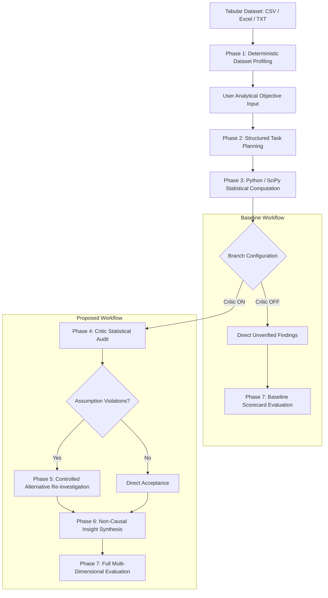

# DataInvest AI: An LLM-Based Autonomous Multi-Agent Framework for Data Investigation with Critic Agent-Driven Statistical Self-Verification

[](https://www.python.org/)
[](https://fastapi.tiangolo.com/)
[](https://react.dev/)
[-lightgrey.svg)](#license)

> **Academic Research Prototype**  
> An autonomous multi-agent framework for tabular data investigation combining natural-language analytical planning with finding-level statistical self-verification and controlled alternative re-investigation.

---

## Overview

**DataInvest AI** is a specialized multi-agent framework designed for transparent, reliable, and automated tabular data investigation. While modern large language models (LLMs) and autonomous data science agents can rapidly explore datasets and generate analytical code, they often produce unchecked statistical claims—applying tests where mathematical assumptions fail, overlooking extreme outlier leverage, or confusing correlation with causation.

DataInvest AI addresses this reliability gap by decoupling investigation planning from execution and introducing a dedicated, deterministic **Statistical Critic Agent**. The framework autonomously profiles datasets, translates user objectives into structured analytical task graphs, executes rigorous statistical tests via SciPy, audits every finding against mathematical and distributional assumptions, and conducts controlled re-investigations when violations occur.

---

## Problem Statement

Conventional automated exploratory data analysis (EDA) tools and emerging LLM-driven analytics agents exhibit several critical limitations in scientific and business settings:

1. **Parametric Assumption Neglect:** Parametric hypothesis tests (e.g., Pearson correlation, Student's/Welch's $t$-tests, One-way ANOVA) are routinely executed without verifying underlying distributional assumptions (normality, homoscedasticity, or group sample balance).
2. **Sparse Contingency Violations:** Asymptotic Chi-square tests of independence are frequently applied to sparse categorical cross-tabulations that violate Cochran's (1954) criteria ($\min(E) \ge 1.0$ and $\le 20\%$ of cells with $E < 5.0$), leading to inflated Type I error rates.
3. **Outlier Leverage Distortion:** Linear relationships and summary metrics are vulnerable to extreme observation leverage ($|z| > 3.0$ or high residual leverage), creating spurious statistical significance without diagnostic awareness.
4. **Absence of Controlled Recourse:** When an analytical test is compromised, existing systems typically either report the invalid result as ground truth or rely on unconstrained LLM re-prompting. They lack a deterministic, bounded protocol to substitute appropriate non-parametric alternatives while preserving analytical intent.
5. **Causal Overclaiming:** Exploratory insights generated from observational data frequently employ causal language (e.g., *"X drives Y"* or *"X leads to Y"*), conflating statistical association with causal mechanisms.

---

## Research Contribution

The core research contribution of DataInvest AI centers on **statistical self-verification and controlled re-investigation**:

1. **Finding-Level Statistical Reliability Assessment:** Rather than relying solely on code syntax verification or unconstrained LLM reflection, the **Critic Agent** evaluates explicit mathematical criteria for every generated finding:
   - Cochran (1954) expected cell frequency thresholds for contingency tables.
   - Distributional normality (Shapiro-Wilk / D'Agostino-Pearson tests) prior to parametric group comparisons.
   - Extreme residual leverage and outlier influence detection ($|z| > 3.0$ and IQR-based sensitivity shift).
   - Target leakage and watermark exploitation detection in predictive features.
2. **Controlled Critic-Driven Re-investigation:** When an assumption violation is flagged, the framework initiates a strictly bounded, **1-budget alternative test substitution protocol**:
   - Parametric correlation tests are systematically swapped to rank-based non-parametric alternatives (Pearson $r \rightarrow$ Spearman $\rho$).
   - Parametric group comparisons are substituted with distribution-free tests (Welch's $t \rightarrow$ Mann-Whitney $U$, ANOVA $\rightarrow$ Kruskal-Wallis $H$).
   - Designated bivariate variable pairs are strictly preserved during re-testing, preventing cross-pair contamination.
   - Quantitative effect-size deltas ($\Delta \text{effect}$, $\Delta p$-value) are computed and audited.
3. **P-Hacking Prevention & Negative Result Retention:** Non-significant findings (e.g., $p \ge 0.05$) are preserved honestly with transparent reason codes rather than repeatedly re-tested or discarded.
4. **Deterministic Multi-Dimensional Evaluation:** System performance is measured through an automated 4-dimension scorecard (0–100 scale) assessing Execution Reliability, Statistical Rigor, Verification Grounding, and Insight Actionability.

---

## Objectives

- **Objective 1:** Design and implement a modular multi-agent data investigation pipeline comprising Profiler, Planner, Analysis, Critic, Verification, Report, and Evaluation agents.
- **Objective 2:** Construct a deterministic Statistical Critic Agent capable of auditing mathematical assumptions, expected frequencies, and outlier sensitivity on tabular findings.
- **Objective 3:** Implement a controlled 1-budget alternative re-investigation service that substitutes robust non-parametric tests upon assumption violations without variable drift.
- **Objective 4:** Establish a matched-pair single-plan empirical benchmark comparing Baseline (Critic OFF) and Proposed (Critic ON) pipelines across candidate tabular datasets.
- **Objective 5:** Evaluate the framework against published literature standards—specifically the AutoMind (*IEEE Access*, 2026) base paper—across analytical rigor, execution stability, and non-causal reporting standards.

---

## System Architecture

DataInvest AI is structured as a pipeline of specialized autonomous agents:

```
┌───────────────────────────────────────────────────────────────────────────────────┐
│                               SHARED INITIAL PIPELINE                             │
├─────────────────────┐       ┌──────────────────────┐       ┌──────────────────────┤
│ 1. Dataset Profiler │ ───>  │   2. Planner Agent   │ ───>  │  3. Analysis Agent   │
│ (Schema, Stats, IQR)│       │ (Gemini LLM / Heur.) │       │ (Exact SciPy Tests)  │
└─────────────────────┘       └──────────────────────┘       └──────────────────────┘
                                                                        │
                                   ┌────────────────────────────────────┴────────┐
                                   │ Shared Raw Findings & Calculations          │
                                   ▼                                             ▼
┌──────────────────────────────────────────────┐  ┌──────────────────────────────────────────────┐
│        BASELINE BRANCH (Critic OFF)          │  │         PROPOSED BRANCH (Critic ON)          │
├──────────────────────────────────────────────┤  ├──────────────────────────────────────────────┤
│ • Critic: Bypassed (None)                    │  │ • 4. Critic Agent: Cochran, Normality &      │
│ • Re-investigation: Bypassed (None)          │  │      Outlier Audits                          │
│ • Verified Insights: Bypassed (None)         │  │ • 5. Verification Agent: 1-Budget Non-       │
│ • Direct Reporting of Raw Output             │  │      Parametric Alternative Substitution     │
│ • Phase 7 Baseline Scorecard Evaluation      │  │ • 6. Report Agent: Non-Causal Grounded Report│
│                                              │  │ • 7. Evaluation Agent: Full 4-Dim Scorecard  │
└──────────────────────────────────────────────┘  └──────────────────────────────────────────────┘
```

### Agent Roles

1. **Dataset Profiler (Phase 1):** Scans raw tabular inputs (CSV/Excel/TXT) deterministically, extracting dimensions, data types, exact summary statistics (mean, median, standard deviation, quartiles, IQR bounds), missingness percentages, duplicate records, and constant or high-cardinality columns.
2. **Planner Agent (Phase 2):** Decomposes natural-language analytical goals into a structured, prioritized directed task graph (bivariate correlations, two-group comparisons, ANOVA, contingency analyses, and outlier checks). Operates via genuine Gemini LLM (`gemini-3.5-flash-lite`) or an offline deterministic heuristic fallback.
3. **Analysis Agent (Phase 3):** Executes planned statistical tests deterministically using Python (`scipy.stats`, `statsmodels`, `numpy`). Generates exact test statistics, degrees of freedom, $p$-values, effect sizes, and interactive Vega-Lite visual specifications.
4. **Critic Agent (Phase 4):** Evaluates mathematical and procedural assumptions across all generated findings. Assigns finding-level verdicts: `ACCEPTED`, `REQUIRES_REINVESTIGATION`, or `QUESTIONABLE` / `REJECTED`.
5. **Verification & Re-investigation Agent (Phase 5):** Executes controlled test substitutions for findings flagged by the Critic Agent. Re-computes statistics under robust non-parametric formulations, strictly preserving variable pairs and preventing p-hacking.
6. **Report Agent (Phase 6):** Synthesizes verified findings into executive summaries and research reports while enforcing lexical non-causal constraints on observational data.
7. **Evaluation Agent (Phase 7):** Computes a calibrated 4-dimension scorecard assessing Execution Reliability (25 pts), Statistical Rigor (25 pts), Verification Grounding (25 pts), and Insight Actionability (25 pts).

---

## Investigation Workflow

The end-to-end operational flow proceeds through eight sequential phases:



---

## Baseline vs Proposed

To scientifically isolate the impact of the Statistical Critic Agent, DataInvest AI implements a **matched-pair single-plan ablation protocol**:

- **Baseline (Critic OFF):**
  Represents standard autonomous data analysis frameworks. The dataset is profiled, planned, and computed, but findings bypass mathematical assumption auditing, outlier verification, and re-investigation. Raw statistical results are reported directly.
- **Proposed (Critic ON):**
  The Critic Agent and Verification Service audit every finding generated from the shared plan and analysis. Compromised findings undergo bounded non-parametric re-investigation before verified reporting.
- **Fairness Controls:**
  - Both branches evaluate the **identical dataset profile**, the **exact same LLM plan**, and the **identical initial SciPy calculations**.
  - Shared planning and analysis runtimes are recorded separately under `shared_duration_seconds`.
  - The computational cost of verification is strictly isolated under `proposed_overhead_seconds`.

---

## Datasets

The project defines five candidate datasets for empirical evaluation, representing diverse data types, sample sizes, and analytical challenges:

| # | Dataset | Analytical Task | File(s) | Status in Repository |
| :-: | :--- | :--- | :--- | :--- |
| **1** | **Heart Disease** | Binary disease classification & clinical factor correlation | `heart.csv` / `processed.cleveland.txt` | **Experiment completed** (9 runs in run store; mandatory test fixtures `58c9f0` and `ffd27c` validated) |
| **2** | **Customer Segmentation** | Customer profiling & spending habit investigation | `Customers.csv` | **Experiment completed** (2 full runs in run store; benchmark script verified) |
| **3** | **Education Factors** | Academic performance prediction & study habit association | `educational-factors.xlsx` (sheet `data`) / `student-mat.csv` | **Experiment completed** (7 runs in run store; paired baseline/proposed runs verified) |
| **4** | **Fake News** | Text classification & publisher watermark leakage audit | `Fake.csv` + `True.csv` | **Candidate dataset available**; offline benchmark script (`run_fake_news_benchmark.py`) and live execution log present |
| **5** | **ShopMania** | Hierarchical multi-class e-commerce product categorization | `shopmania.csv` | **Experiment completed locally** (4 historical runs generated; excluded from Git tracking due to >100 MB file sizes) |

> [!NOTE]
> Additional legacy reference benchmarks (`winequality-red.csv`, `bank-full.csv`, `adult.txt`) are also present in `data/` and documented in historical evaluation reports.

---

## Technology Stack

### Backend
- **Core Runtime:** Python 3.11+
- **API Framework:** FastAPI (`fastapi>=0.111.0`), Uvicorn (`uvicorn[standard]>=0.29.0`)
- **Data & Computation:** Pandas (`>=2.1.0`), NumPy (`>=1.26.0`), SciPy (`>=1.11.0`), Scikit-learn (`>=1.4.0`)
- **Data Validation & Typing:** Pydantic v2 (`>=2.0.0`)
- **Data Ingestion & Visualization:** Python-multipart, OpenPyXL, Pillow, Altair (`>=5.0.0`)
- **HTTP Client & Configuration:** HTTPX (`>=0.27.0`), Python-dotenv (`>=1.0.0`)
- **Testing:** Pytest (`>=8.0.0`)

### LLM Planning Integration
- **Provider:** Google Generative AI REST API (`gemini-3.5-flash-lite`)
- **Architecture:** Decoupled `GeminiClient` with automated JSON schema validation, retry backoff, and full offline/deterministic fallback support.

### Frontend
- **Framework:** React 19 (`react`, `react-dom`)
- **Build Tool:** Vite 8 (`vite`, `@vitejs/plugin-react`)
- **Visualizations:** Vega (`^6.4.0`), Vega-Lite (`^6.5.0`), Vega-Embed (`^7.3.0`)
- **HTTP Client:** Axios (`^1.20.0`)
- **Linter & Tests:** Oxlint (`^1.79.0`), Node.js built-in test runner (`node --test`)

---

## Project Structure

```text
Major_Project/
├── backend/
│   ├── app/
│   │   ├── main.py                  ← FastAPI application entry point, CORS & routes
│   │   ├── agents/
│   │   │   ├── planner_agent.py     ← Phase 2 Planner Agent (Gemini LLM & Heuristic)
│   │   │   ├── analysis_agent.py    ← Phase 3 Statistical Analysis Agent (SciPy)
│   │   │   ├── critic_agent.py      ← Phase 4 Statistical Critic Agent (Audits)
│   │   │   ├── verification_agent.py← Phase 5 Verification & Reinvestigation Agent
│   │   │   ├── report_agent.py      ← Phase 6 Report Agent (Non-causal synthesis)
│   │   │   └── evaluation_agent.py  ← Phase 7 Evaluation Agent (4-dimension scorecard)
│   │   ├── modules/
│   │   │   └── profiler.py          ← Phase 1 Dataset Profiler Engine
│   │   ├── schemas/                 ← Pydantic response & request contracts
│   │   └── services/                ← Planning, execution, run-store & evaluation services
│   ├── data/
│   │   └── runs/                    ← Verified historical experiment runs (.json)
│   ├── scripts/                     ← Reproducible benchmark & evaluation runners
│   ├── tests/                       ← Pytest unit, safety, and integration test suite
│   └── requirements.txt             ← Backend production dependencies
│
├── frontend/
│   ├── src/
│   │   ├── components/              ← Phase UI components (Profile, Plan, Critic, Charts)
│   │   ├── pages/                   ← Main application views (Home, History)
│   │   ├── services/
│   │   │   └── api.js               ← Dynamic API client resolving VITE_API_BASE_URL
│   │   └── tests/                   ← Frontend unit tests (API base URL resolution)
│   ├── package.json                 ← Frontend dependencies and scripts
│   ├── vercel.json                  ← Vercel SPA routing rewrite rules
│   └── vite.config.js               ← Vite server configuration & /api proxy
│
├── data/                            ← Benchmark datasets (sample, cleveland, student, etc.)
├── docs/                            ← Research protocols, UI audits & base paper mappings
├── reports/                         ← Formal comparative evaluation reports
├── render.yaml                      ← Render Web Service deployment descriptor
├── requirements.txt                 ← Root Python dependency descriptor
└── README.md                        ← Project overview and documentation
```

---

## Installation

### Prerequisites
- **Python 3.11+**
- **Node.js 18+** & **npm**
- **Git**

### Clone Repository
```bash
git clone <repository-url>
cd Major_Project
```

### 1. Backend Dependencies
```bash
# Create and activate a Python virtual environment
python -m venv .venv

# Windows:
.venv\Scripts\activate
# Linux / macOS:
source .venv/bin/activate

# Install backend dependencies
pip install -r backend/requirements.txt
```

### 2. Frontend Dependencies
```bash
cd frontend
npm install
cd ..
```

---

## Backend Setup

### Local Development
```bash
# From project root with virtual environment active:
cd backend
python -m uvicorn app.main:app --reload --host 127.0.0.1 --port 8000
```
- **API Swagger Documentation:** `http://127.0.0.1:8000/docs`
- **Backend Health Check:** `http://127.0.0.1:8000/health`

---

## Frontend Setup

### Local Development
```bash
# In a separate terminal:
cd frontend
npm run dev
```
- **Web Application Interface:** `http://localhost:5173/`

### Frontend Production Build
```bash
cd frontend
npm run build
```
Generates production-ready static assets in `frontend/dist/`.

---

## Environment Variables

DataInvest AI operates in a **zero-configuration offline mode by default**. Environment variables can be configured via `backend/.env` for local development or within cloud provider settings:

| Variable | Scope | Required? | Description |
| :--- | :--- | :---: | :--- |
| `GEMINI_API_KEY` | Backend | **No** (Optional) | API key for Google Gemini Generative AI REST API (`gemini-3.5-flash-lite`). When omitted, the system operates deterministically using the heuristic planner and offline demo. |
| `CORS_ORIGINS` | Backend | No | Comma-separated list of allowed frontend origins (e.g. `http://localhost:5173,https://your-app.vercel.app`). Wildcards (`*`) are disallowed when `DATAINVEST_PRODUCTION=true`. |
| `DATAINVEST_PRODUCTION` | Backend | No | Set to `"true"` in production environments to activate strict CORS policies, disable run deletion endpoints (HTTP 403), and enforce rate limiting. |
| `PORT` | Backend | No | Server port for Uvicorn binding (defaults to `8000` locally, assigned dynamically on cloud platforms such as Render). |
| `VITE_API_BASE_URL` | Frontend | No | Base URL of the backend API (e.g. `https://datainvest-api.onrender.com`). In local development, defaults to `/api` proxied via Vite. |

> [!NOTE]
> The current implementation connects to Gemini via direct REST requests. Ollama or local LLM daemons are not utilized in the current codebase.

---

## Experiments and Evaluation

### Automated Test Suites

```bash
# Run backend safety, integrity, and regression test suite
cd backend
python -m pytest tests/test_deployment_safety.py tests/test_controlled_critic_experiment.py tests/test_api.py tests/test_stage_c.py -v

# Run frontend unit tests
cd ../frontend
npm test
```
*Current test verification:* 34 backend pytest tests pass, 38 frontend tests pass, and the Vite production build succeeds with zero errors.

### Evaluating Historical Runs
The application ships with **20 verified historical experiment runs** located in `backend/data/runs/`. When the frontend is launched, the **Experiment History** modal automatically hydrates these records from disk, allowing reviewers to inspect complete Phase 1–7 artifacts, Vega-Lite visual diagnostic plots, and Critic verification scorecards without incurring API charges.

---

## Results

Empirical results documented in [reports/FINAL_COMPARATIVE_EVALUATION.md](file:///c:/Users/SPURGE/MAJOR_PROJECT_DOCS/REVIEW%202/Major_Project/reports/FINAL_COMPARATIVE_EVALUATION.md) demonstrate the impact of Critic-driven verification across benchmark datasets (`student-mat.csv`, `winequality-red.csv`, `bank-full.csv`, `processed.cleveland.txt`, `adult.txt`):

| Evaluation Metric | Baseline (Critic OFF) | Proposed (Critic ON) | Metric Delta ($\Delta$) | Evidence & Notes |
| :--- | :---: | :---: | :---: | :--- |
| **Composite Score** | 33.34 / 100 | **84.32 / 100** | **+50.98 pts** | Reflects structural inclusion of auditing, verification, and insight synthesis |
| **Statistical Rigor** | 8.5 / 25.0 | **20.9 / 25.0** | **+12.4 pts** | Audits Cochran expected cell rules, normality, and leverage bounds |
| **Verification Grounding** | 0.0 / 25.0 | **19.8 / 25.0** | **+19.8 pts** | Deterministic SciPy computation and re-investigation provenance |
| **Reinvestigation Resolution** | N/A (Bypassed) | **100.0% (4 / 4)** | **+100.0%** | All 4 assumption-compromised findings successfully resolved via non-parametric tests |
| **P-Hacking Retention** | N/A | **Zero Discarded** | **Preserved** | Non-significant findings (e.g. `trestbps` vs `target`, $p=0.1425$) retained with honest reporting |
| **Findings Yield** | Raw findings | **88.9% Verified** | **3 Questionable** | Distribution-fragile findings (e.g. zero-inflated capital gains) caveated as `QUESTIONABLE` |

*Note on Score Interpretation:* As stated in the research protocol, the score delta reflects the structural inclusion of auditing and verification stages in the proposed pipeline. It is an internal ablation measure and is not claimed as general empirical superiority over external multi-agent systems.

---

## Screenshots / Demo

High-resolution UI audit captures documenting the full pipeline are archived in `docs/ui_audit_task12/`:

| Pipeline Stage | Capture Reference | Description |
| :--- | :--- | :--- |
| **Dataset Upload** | `docs/ui_audit_task12/01_home_dataset_selection_1440x900.png` | Drag-and-drop CSV upload and profile initialization |
| **Experiment History** | `docs/ui_audit_task12/02_experiment_history_modal_1440x900.png` | Run store modal with run hydration and metric badges |
| **Phase 1: Profiler** | `docs/ui_audit_task12/03_restored_phase1_dataset_profile_1440x900.png` | Summary statistics, missing values, duplicates, and IQR outlier cards |
| **Phase 2: Planner** | `docs/ui_audit_task12/04_restored_phase2_planner_1440x900.png` | Natural-language objective decomposition into prioritized task cards |
| **Phase 3: Analysis** | `docs/ui_audit_task12/05_restored_phase3_analysis_results_vega_1440x900.png` | Exact SciPy statistics and interactive Vega-Lite diagnostic plots |
| **Phase 4: Critic** | `docs/ui_audit_task12/06_restored_phase4_critic_verdict_1440x900.png` | Finding-level assumption audits, Cochran checks, and verdicts |
| **Phase 5: Verification** | `docs/ui_audit_task12/07_restored_phase5_verified_reinvestigation_1440x900.png` | Controlled 1-budget alternative test substitution and delta audits |
| **Phase 6: Insights** | `docs/ui_audit_task12/08_restored_phase6_insights_hypotheses_1440x900.png` | Non-causal observation synthesis and hypothesis generation |
| **Phase 7: Evaluation** | `docs/ui_audit_task12/09_restored_phase7_evaluation_scorecard_1440x900.png` | Multi-dimensional 4-dimension scorecard with letter grades |

---

## Deployment

The repository includes pre-configured deployment manifests:
- **Backend:** [render.yaml](file:///c:/Users/SPURGE/MAJOR_PROJECT_DOCS/REVIEW%202/Major_Project/render.yaml) configured for Render Web Service (FastAPI, Python 3.11, Uvicorn).
- **Frontend:** [frontend/vercel.json](file:///c:/Users/SPURGE/MAJOR_PROJECT_DOCS/REVIEW%202/Major_Project/frontend/vercel.json) configured for Vercel (Vite static build with SPA rewrites).

> [!NOTE]
> **Deployment Status:** Deployment configurations are prepared and validated. The repository has not yet been pushed to a public remote, and the live cloud services have not yet been activated. The application is currently verified for local execution and manual deployment.

---

## Limitations

- **Procedural Compliance vs. Truth:** Critic acceptance indicates procedural compliance with predefined statistical criteria (normality thresholds, minimum cell counts, outlier bounds). It does not constitute mathematical proof or establish underlying ground truth.
- **Observational Data Boundaries:** Statistical associations identified by the system reflect observational patterns and cannot establish causal mechanisms without experimental control or explicit causal modeling.
- **Ephemeral Storage on Free Cloud Tiers:** On ephemeral hosting environments (such as Render free tier), newly created runs during a live session persist in container memory and local disk, but reset if the free container spins down due to inactivity. Committing verified runs to Git ensures permanent availability.
- **Cold Start Latency:** Free-tier cloud containers may experience 30–50 second cold-start delays on initial requests after idle periods.

---

## Future Scope

- **Formal Causal Inference Integration:** Incorporating directed acyclic graphs (DAGs), structural equation models, and Do-calculus to evaluate potential causal hypotheses from observational data.
- **Extended Time-Series & Spatial Audits:** Expanding the Critic Agent to evaluate stationarity (ADF tests), autocorrelation (Durbin-Watson), cointegration, and spatial dependence.
- **Persistent Cloud Object Storage:** Integrating S3-compatible cloud storage (e.g. AWS S3 or Cloudflare R2) for persistent run hydration across container lifecycles.
- **Local Open-Source LLM Support:** Adding native Ollama or vLLM adapters to support self-hosted open-weights models in air-gapped or privacy-sensitive research environments.

---

## Base Paper / Reference

This project is grounded in and benchmarked against the following peer-reviewed scientific literature:

- **Title:** AutoMind: Automated Insight Discovery via Multi-Agent Navigation
- **Authors:** Cong Nguyen Thanh, Son Nguyen Van, Hao Nguyen Ngoc, Cuong Van Duc, Hieu Nguyen Minh, Dung Nguyen Tien, Hanh Nguyen Thi
- **Affiliations:** Hanoi University, Phenikaa University, Hanoi University of Science and Technology (HUST), Vietnam
- **Journal:** *IEEE Access*, 2026, Volume 14, pages 23936–23955
- **Publication Date:** February 6, 2026
- **Electronic ISSN:** 2169-3536
- **DOI:** [10.1109/ACCESS.2026.3661202](https://doi.org/10.1109/ACCESS.2026.3661202)
- **IEEE Xplore Record:** [https://ieeexplore.ieee.org/document/11372738/](https://ieeexplore.ieee.org/document/11372738/)

> [!NOTE]
> **Disambiguation Notice:** Strictly distinguished from the unrelated preprint *"AutoMind: Adaptive Knowledgeable Agent for Automated Data Science"*, arXiv:2506.10974 (2025). All attributions, feature lineage mappings, and benchmark alignments in this project refer exclusively to the peer-reviewed *IEEE Access* 2026 publication.

---

## Academic Project Note

This software is developed as a final-year **B.Tech Major Project research prototype** (Review 2 stage):

- **Project Title:** *An LLM-Based Autonomous Multi-Agent Framework for Data Investigation with Critic Agent-Driven Statistical Self-Verification*
- **Application Name:** DataInvest AI
- **Academic Focus:** Autonomous Multi-Agent Systems, Exploratory Data Analysis, Applied Computational Statistics, and LLM Verification Guardrails.

---

## License

This repository currently has **no open-source license**. All rights are reserved by the project authors. Unauthorized copying, distribution, or public commercial deployment without explicit permission is prohibited.
