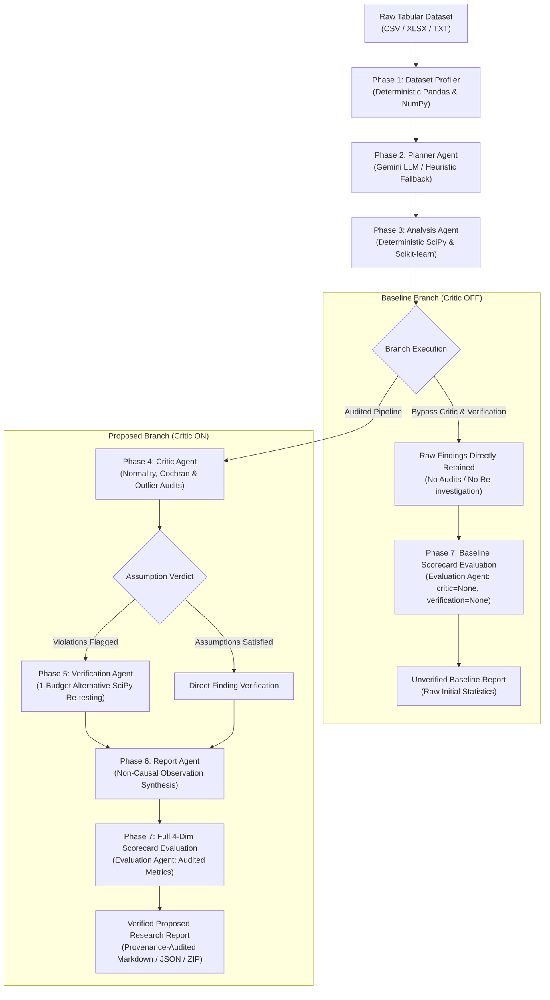

# DataInvest AI: An LLM-Based Autonomous Multi-Agent Framework for Data Investigation with Critic Agent-Driven Statistical Self-Verification

[](https://www.python.org/)
[](https://fastapi.tiangolo.com/)
[](https://react.dev/)
[](#license)

> **Academic Research Prototype**
> An autonomous multi-agent framework for tabular data investigation combining natural-language analytical planning with finding-level statistical self-verification and controlled alternative re-investigation.

- **Live Application:** [https://data-invest-ai.vercel.app](https://data-invest-ai.vercel.app)
- **GitHub Repository:** [https://github.com/nithya12-star/DataInvest-AI](https://github.com/nithya12-star/DataInvest-AI)
- **Backend API Service:** [https://datainvest-api.onrender.com](https://datainvest-api.onrender.com)

---

## Table of Contents

1. [Project Overview](#project-overview)
2. [Problem Statement and Motivation](#problem-statement-and-motivation)
3. [Research Objectives](#research-objectives)
4. [Main Research Contribution](#main-research-contribution)
5. [System Architecture](#system-architecture)
6. [Investigation Workflow](#investigation-workflow)
7. [Baseline vs Proposed Methodology](#baseline-vs-proposed-methodology)
8. [Approved Evaluation Datasets](#approved-evaluation-datasets)
9. [Technology Stack](#technology-stack)
10. [Project Directory Structure](#project-directory-structure)
11. [Installation and Local Execution](#installation-and-local-execution)
12. [Live Deployment](#live-deployment)
13. [Testing and Validation](#testing-and-validation)
14. [Experimental Evaluation](#experimental-evaluation)
15. [Screenshots and Demonstration](#screenshots-and-demonstration)
16. [Limitations and Future Scope](#limitations-and-future-scope)
17. [Base Paper and References](#base-paper-and-references)
18. [Academic Project Information](#academic-project-information)
19. [License](#license)

---

## Project Overview

**DataInvest AI** is a specialized multi-agent research framework designed for transparent, reliable, and reproducible automated tabular data investigation. While modern large language models (LLMs) and autonomous data science agents can rapidly explore datasets and generate analytical code, they frequently produce unchecked statistical claims—applying tests where mathematical assumptions fail, overlooking extreme outlier leverage, accepting impossible domain values, or confusing correlation with causation.

DataInvest AI addresses this reliability gap by decoupling analytical planning from statistical execution and introducing a dedicated, deterministic **Statistical Critic Agent** coupled with a **Controlled Re-investigation Service**. The framework autonomously profiles tabular datasets, translates natural-language user objectives into structured analytical task graphs, executes statistical tests via SciPy and Scikit-learn, audits every individual finding against distributional and procedural assumptions, and triggers bounded alternative re-investigations when violations occur.

---

## Problem Statement and Motivation

Conventional automated exploratory data analysis (EDA) tools and emerging LLM-driven data investigation agents exhibit several critical vulnerabilities in scientific and decision-critical contexts:

1. **Parametric Assumption Neglect:** Parametric hypothesis tests (e.g., Pearson correlation, Student's/Welch's $t$-tests, One-way ANOVA) are routinely executed without verifying underlying distributional requirements such as normality, homoscedasticity, or adequate sample sizes.
2. **Sparse Contingency Violations:** Asymptotic Chi-square tests of independence are frequently computed on sparse categorical cross-tabulations that violate Cochran's (1954) criteria ($\min(E) \ge 1.0$ and $\le 20\%$ of cells with $E < 5.0$), leading to inflated Type I error rates.
3. **Outlier Leverage Distortion:** Linear relationships and summary metrics are vulnerable to extreme observation leverage ($|z| > 3.0$ or high residual influence), creating spurious statistical significance without diagnostic awareness.
4. **Domain-Specific Impossible Values:** Zero values in clinical or physical metrics (e.g., resting blood pressure = 0 mm Hg or serum cholesterol = 0 mg/dL) are frequently treated as valid numeric measurements rather than missing data artifacts.
5. **Absence of Deterministic Recourse:** When an analytical test is compromised, existing systems typically either report the invalid result as ground truth or rely on unconstrained, stochastic LLM re-prompting. They lack a deterministic protocol to substitute appropriate non-parametric alternatives on the raw dataset while preserving analytical intent.
6. **Causal Overclaiming:** Exploratory insights generated from observational data frequently employ causal language (e.g., *"X drives Y"* or *"X causes Y"*), conflating statistical association with causal mechanisms.

---

## Research Objectives

- **Objective 1:** Design and implement a modular multi-agent data investigation architecture comprising specialized Profiler, Planner, Analysis, Critic, Verification, Report, and Evaluation agents.
- **Objective 2:** Construct a deterministic Statistical Critic Agent capable of auditing mathematical assumptions, minimum cell counts, outlier sensitivity, and domain-specific data anomalies on tabular findings.
- **Objective 3:** Implement a controlled 1-budget alternative re-investigation service that substitutes robust non-parametric tests or audited imputations upon assumption violations without variable drift.
- **Objective 4:** Establish a matched-pair single-plan empirical benchmark methodology comparing Baseline (Critic OFF) and Proposed (Critic ON) pipelines on identical dataset profiles and initial calculations.
- **Objective 5:** Evaluate the framework across diverse guide-approved benchmark datasets (Fake News, Heart Disease, Customer Segmentation, Education Survey, and ShopMania) with transparent statistical provenance and negative result retention.

---

## Main Research Contribution

The core research contribution of DataInvest AI centers on **statistical self-verification and controlled re-investigation**:

1. **Finding-Level Statistical Reliability Assessment:** Rather than relying solely on code syntax verification or open-ended LLM reflection, the **Critic Agent** evaluates explicit mathematical and procedural criteria for every generated finding:
   - Cochran (1954) expected cell frequency thresholds for contingency tables.
   - Distributional normality (Shapiro-Wilk test) prior to parametric group comparisons.
   - Extreme residual leverage and outlier influence detection (IQR bounds and trimmed-mean sensitivity).
   - Domain-specific impossible value detection (e.g., impossible clinical zeros).
   - Class and group sample size imbalance audits.
2. **Controlled Critic-Driven Re-investigation:** When an assumption violation is flagged, the framework initiates a strictly bounded, **1-budget alternative test substitution protocol**:
   - Parametric correlations are systematically substituted with rank-based alternatives (Pearson $r \rightarrow$ Spearman $\rho$).
   - Parametric group comparisons are substituted with distribution-free tests (Welch's $t \rightarrow$ Mann-Whitney $U$, ANOVA $\rightarrow$ Kruskal-Wallis $H$).
   - Impossible values undergo audited median imputation with before-and-after re-testing on the raw DataFrame.
   - Designated variable pairs are strictly preserved during re-testing, preventing cross-pair contamination.
   - Quantitative effect-size deltas ($\Delta \text{effect}$, $\Delta p$-value) are computed and audited.
3. **P-Hacking Prevention & Negative Result Retention:** Non-significant findings (e.g., $p \ge 0.05$) are preserved honestly with transparent reason codes rather than repeatedly re-tested or discarded.
4. **Transparent Reporting & Verification Provenance:** Every re-investigated finding records full comparative provenance (`ReinvestigationRecord`), including original method, alternative method, shifts in test statistics, effect sizes, and side-by-side visual evidence.

---

## System Architecture

DataInvest AI decomposes tabular investigation into a sequence of seven specialized agents:



### Implemented Agent Roles

1. **Dataset Profiler (`app/modules/profiler.py`):** Scans raw tabular inputs deterministically, extracting dimensions, data types, exact summary statistics (mean, median, standard deviation, quartiles, IQR bounds), missingness percentages, duplicate records, and constant or high-cardinality columns.
2. **Planner Agent (`app/agents/planner_agent.py`):** Translates user analytical goals into a structured, prioritized directed task graph across 14 supported task types (bivariate correlations, two-group comparisons, ANOVA, contingency analyses, classification, and clustering). Operates via Gemini LLM (`gemini-3.5-flash-lite`) or an offline deterministic heuristic fallback.
3. **Analysis Agent (`app/agents/analysis_agent.py`):** Executes planned analytical tasks deterministically using Python (`scipy.stats`, `sklearn`, `numpy`). Generates exact test statistics, degrees of freedom, $p$-values, effect sizes (Cohen's $d$, $\eta^2$, Cramér's $V$), and Vega-Lite visual diagnostic specifications.
4. **Critic Agent (`app/agents/critic_agent.py`):** Evaluates mathematical and procedural assumptions across all generated findings. Assigns finding-level verdicts (`ACCEPTED`, `QUESTIONABLE`, `REJECTED`, or `REQUIRES_REINVESTIGATION`) with explicit decision certainty ratings.
5. **Verification & Re-investigation Agent (`app/services/verification_service.py`):** Executes controlled test substitutions for findings flagged by the Critic Agent directly on the raw DataFrame via SciPy, enforcing a hard limit of `MAX_REINVESTIGATIONS = 1`.
6. **Report Agent (`app/agents/report_agent.py`):** Synthesizes verified findings into executive summaries and structured Markdown reports while enforcing non-causal language constraints on observational data.
7. **Evaluation Agent (`app/services/evaluation_service.py`):** Computes a calibrated 100-point scorecard across four dimensions: Execution Reliability (25 pts), Statistical Rigor (25 pts), Verification Grounding (25 pts), and Insight Actionability (25 pts).

---

## Investigation Workflow

The end-to-end investigation workflow proceeds through sequential phases:

```mermaid
flowchart TD
    W1["Phase 1: Dataset Upload & Profiling"] --> W2["Phase 2: Structured Analytical Planning"]
    W2 --> W3["Phase 3: Python / SciPy Statistical Computation"]
    W3 --> W4{"Branch Selection"}

    W4 -->|Baseline (Critic OFF)| WB1["Direct Unverified Evaluation (Phase 7)"]
    WB1 --> WB2["Unverified Raw Output Export"]

    W4 -->|Proposed (Critic ON)| WP1["Phase 4: Statistical Critic Audit"]
    WP1 --> WP2{"Assumption Checks"}
    WP2 -->|Violations Flagged| WP3["Phase 5: Alternative Re-investigation (SciPy)"]
    WP2 -->|Passed| WP4["Direct Finding Acceptance"]
    WP3 --> WP5["Phase 6: Non-Causal Insights Synthesis"]
    WP4 --> WP5
    WP5 --> WP6["Phase 7: Full Multi-Dimensional Evaluation"]
    WP6 --> WP7["Verified Research Report & PKZIP Archive"]
```

1. **Phase 1 — Dataset Profiling:** The user uploads a CSV, XLSX, or TXT file. The Profiler scans the file, detects dtypes and OpenXML worksheets, and computes summary statistics and data quality flags.
2. **Phase 2 — Analytical Planning:** The user defines an analytical goal. The Planner Agent constructs an ordered task list with analytical justifications.
3. **Phase 3 — Statistical Analysis:** The Analysis Agent executes each task via SciPy / Scikit-learn and generates statistical summaries and Vega-Lite chart specifications.
4. **Phase 4 — Critic Review:** The Critic Agent audits each finding for normality violations, minimum sample size, zero variance, impossible domain values, and expected cell counts.
5. **Phase 5 — Controlled Re-investigation:** Flagged findings trigger alternative non-parametric tests or median imputations on the raw DataFrame. Shifts in statistics and effect sizes are recorded.
6. **Phase 6 — Key Insights Synthesis:** Findings are compiled into categorized observations with explicit evidence citations, confidence levels, and non-causal wording.
7. **Phase 7 — Evaluation Scorecard:** The system generates a calibrated 100-point scorecard and allows exporting the complete research run as structured JSON, Markdown reports, or a client-side PKZIP archive with SHA-256 checksums.

---

## Baseline vs Proposed Methodology

To evaluate the specific contribution of the Statistical Critic Agent, DataInvest AI employs a **matched-pair single-plan ablation methodology**:

- **Baseline (Critic OFF):**
  Represents standard un-audited automated data analysis pipelines. The dataset is profiled, planned, and computed, but findings bypass mathematical assumption auditing, outlier verification, and re-investigation. Raw statistical results are reported directly.
- **Proposed (Critic ON):**
  The Critic Agent and Verification Service audit every finding generated from the shared plan and analysis. Compromised findings undergo bounded non-parametric re-investigation before verified reporting.
- **Fairness Guarantees (`app/services/experiment_runner.py`):**
  - **Identical Ingestion:** Both branches evaluate the exact same dataset profile.
  - **Shared Plan:** The Planner Agent runs once. The resulting `shared_plan` is serialized and passed to both Baseline and Proposed pipelines.
  - **Shared Initial Analysis:** The initial SciPy calculations run once. Both branches receive identical raw statistical results.
  - **Single Treatment Difference:** The Critic Agent and subsequent verification re-investigation represent the sole independent variable under study.

---

## Approved Evaluation Datasets

The research framework is designed to evaluate five guide-approved benchmark datasets covering distinct analytical tasks and data modalities:

| # | Dataset | Target / Task | Modality & Scale | Pipeline & Verification Support |
| :-: | :--- | :--- | :--- | :--- |
| **1** | **Fake News**<br>`Fake.csv` + `True.csv` | Binary text classification & publisher watermark leakage audit | Text / Tabular<br>(~44,000 articles) | **Benchmark Script Implemented:** Dedicated benchmark harness in [`backend/scripts/run_fake_news_benchmark.py`](backend/scripts/run_fake_news_benchmark.py) merges both corpora, injects labels, and evaluates TF-IDF classification; interactive web UI requires a single pre-merged CSV with a target label column. |
| **2** | **Heart Disease**<br>`heart.csv` | Binary classification of heart disease & clinical factor correlation | Tabular<br>(918 rows $\times$ 12 cols) | **Interactive UI Verified & Benchmark Script Available:** Interactive single-file pipeline verified (profiling, planning, impossible zero detection, median imputation re-investigation) and supervised classification benchmark script in [`backend/scripts/run_heart_classification_benchmark.py`](backend/scripts/run_heart_classification_benchmark.py). |
| **3** | **Customer Segmentation**<br>`Customers.csv` | Unsupervised customer profiling & spending behavior clustering | Tabular<br>(2,000 rows $\times$ 8 cols) | **Interactive UI Verified & Benchmark Script Available:** Interactive single-file pipeline verified (profiling, K-Means clustering, silhouette/inertia audits) and segmentation benchmark script in [`backend/scripts/run_customer_segmentation_benchmark.py`](backend/scripts/run_customer_segmentation_benchmark.py) / [`backend/scripts/run_cross_dataset_benchmark.py`](backend/scripts/run_cross_dataset_benchmark.py). |
| **4** | **Education Factors**<br>`educational-factors.xlsx` | Academic satisfaction survey analysis & factor correlation | OpenXML Sheet `data`<br>(1,680 rows $\times$ 79 cols) | **Worksheet Ingestion Verified & Benchmark Script Available:** Interactive UI verified for multi-sheet OpenXML parsing of sheet `data` (1,680 $\times$ 79) and item-level bivariate analysis; psychometric construct aggregation (Cronbach's alpha) and ordinal regression implemented in [`backend/scripts/run_education_benchmark.py`](backend/scripts/run_education_benchmark.py). |
| **5** | **ShopMania**<br>`shopmania.csv` | High-cardinality multi-class e-commerce product categorization | Text / Catalog<br>(~28 MB, ~180k rows) | **Benchmark Script Implemented (Local Execution):** Stratified top-20 multi-class benchmark script in [`backend/scripts/run_shopmania_benchmark.py`](backend/scripts/run_shopmania_benchmark.py); dataset managed locally due to size (>28 MB). |

> [!NOTE]
> Large benchmark datasets (>50 MB) are managed locally or in staging environments and are not committed to Git tracking to adhere to GitHub repository limits.

---

## Technology Stack

### Backend
- **Language & Runtime:** Python 3.11+
- **API Framework:** FastAPI (`fastapi>=0.111.0`), Uvicorn (`uvicorn[standard]>=0.29.0`)
- **Scientific Computing:** Pandas (`>=2.1.0`), NumPy (`>=1.26.0`), SciPy (`>=1.11.0`), Scikit-learn (`>=1.4.0`)
- **Data Validation & Typing:** Pydantic v2 (`>=2.0.0`)
- **Data Ingestion & Parsing:** OpenXML direct XML parser, Python-multipart, Pillow, Altair (`>=5.0.0`)
- **HTTP Client & Configuration:** HTTPX (`>=0.27.0`), Python-dotenv (`>=1.0.0`)
- **Testing:** Pytest (`>=8.0.0`), AnyIO

### LLM Planning Integration
- **Model:** Google Gemini REST API (`gemini-3.5-flash-lite`) via decoupled client (`app/services/gemini_client.py`).
- **Deterministic Separation:** Planning is the only phase where an LLM is used. Phase 3 (Analysis), Phase 4 (Critic Audits), and Phase 5 (Re-investigation) are **100% deterministic Python/SciPy code with zero LLM API calls**.
- **Offline Fallback:** When `GEMINI_API_KEY` is omitted, the framework switches to a deterministic heuristic planner.

### Frontend
- **Framework:** React 19 (`react`, `react-dom`)
- **Build Tool:** Vite 8 (`vite`, `@vitejs/plugin-react`)
- **Visual Diagnostics:** Vega (`^6.4.0`), Vega-Lite (`^6.5.0`), Vega-Embed (`^7.3.0`)
- **HTTP Client:** Axios (`^1.20.0`)
- **Testing:** Node.js built-in test runner (`node --test`)

### Cloud Infrastructure
- **Frontend Hosting:** Vercel (Single Page Application with routing rewrites via `vercel.json`)
- **Backend Hosting:** Render Web Service (FastAPI container defined in `render.yaml`)

---

## Project Directory Structure

```text
Major_Project/
├── backend/
│   ├── app/
│   │   ├── main.py                  # FastAPI application entry point, CORS & routing
│   │   ├── agents/
│   │   │   ├── planner_agent.py     # Phase 2 Planner Agent (Gemini LLM & Heuristic)
│   │   │   ├── analysis_agent.py    # Phase 3 Analysis Agent (SciPy & Scikit-learn)
│   │   │   ├── critic_agent.py      # Phase 4 Statistical Critic Agent (Audit rules)
│   │   │   ├── report_agent.py      # Phase 6 Report Agent (Non-causal synthesis)
│   │   │   └── __init__.py
│   │   ├── modules/
│   │   │   ├── profiler.py          # Phase 1 Dataset Profiler Engine
│   │   │   └── __init__.py
│   │   ├── schemas/                 # Strongly typed Pydantic v2 data contracts
│   │   ├── services/
│   │   │   ├── dataset_store.py     # Dataset caching, resolution & OpenXML routing
│   │   │   ├── upload_service.py    # OpenXML XLSX parsing & coordinate mapping
│   │   │   ├── verification_service.py # Phase 5 1-Budget re-investigation engine
│   │   │   ├── evaluation_service.py   # Phase 7 4-Dimension scorecard engine
│   │   │   ├── experiment_runner.py    # Paired Baseline vs Proposed orchestrator
│   │   │   ├── gemini_client.py     # Gemini REST client with retry logic
│   │   │   └── run_store_service.py # Atomic run persistence service
│   │   └── statistics/              # Statistical calculation modules
│   ├── data/
│   │   └── runs/                    # Historical experiment run archives (.json)
│   ├── scripts/                     # Reproducible benchmark harnesses
│   ├── tests/                       # Pytest backend test suite (30+ test files)
│   └── requirements.txt             # Backend Python dependencies
│
├── frontend/
│   ├── src/
│   │   ├── components/              # UI components (Profile, Stepper, Critic, Vega)
│   │   ├── pages/
│   │   │   └── Home.jsx             # Pipeline orchestrator view
│   │   ├── services/
│   │   │   ├── api.js               # API client resolving VITE_API_BASE_URL
│   │   │   └── researchArchive.js   # Client-side PKZIP / Markdown export engine
│   │   ├── App.jsx                  # Root React application component
│   │   └── main.jsx                 # Vite application entry point
│   ├── tests/                       # Node.js frontend test suite
│   ├── package.json                 # Frontend dependencies and scripts
│   ├── vercel.json                  # Vercel deployment configuration
│   └── vite.config.js               # Vite bundler & /api proxy configuration
│
├── docs/                            # UI audit captures & preservation guides
├── reports/                         # Evaluation reports and benchmark summaries
├── render.yaml                      # Render Web Service deployment descriptor
├── requirements.txt                 # Root Python dependency specification
└── README.md                        # Project documentation
```

---

## Installation and Local Execution

### Prerequisites
- **Python 3.11+**
- **Node.js 18+** & **npm**
- **Git**

### 1. Clone the Repository
```bash
git clone https://github.com/nithya12-star/DataInvest-AI.git
cd DataInvest-AI
```

### 2. Backend Setup
```bash
# Create Python virtual environment
python -m venv .venv

# Activate virtual environment
# Windows (PowerShell):
.\.venv\Scripts\Activate.ps1
# Windows (Command Prompt):
.\.venv\Scripts\activate.bat
# Linux / macOS:
source .venv/bin/activate

# Install backend dependencies
pip install -r backend/requirements.txt
```

### 3. Frontend Setup
```bash
cd frontend
npm install
cd ..
```

### 4. Running the Application Locally

**Terminal 1 — Backend API:**
```bash
# With virtual environment active:
cd backend
python -m uvicorn app.main:app --reload --host 127.0.0.1 --port 8000
```
- API Documentation (Swagger): `http://127.0.0.1:8000/docs`
- Health Endpoint: `http://127.0.0.1:8000/health`

**Terminal 2 — Frontend UI:**
```bash
cd frontend
npm run dev
```
- Web Application: `http://localhost:5173/`

### 5. Environment Variables
DataInvest AI runs in a **zero-configuration offline mode by default**. Environment variables can be configured via `backend/.env` or cloud dashboards:

| Variable | Scope | Required? | Description |
| :--- | :--- | :---: | :--- |
| `GEMINI_API_KEY` | Backend | Optional | Google Gemini API key. When omitted, the system operates deterministically using the heuristic planner. |
| `CORS_ORIGINS` | Backend | Optional | Comma-separated allowed frontend origins (defaults to `http://localhost:5173,http://localhost:3000`). |
| `DATAINVEST_PRODUCTION` | Backend | Optional | Set to `"true"` in production to activate strict CORS policies and disable run deletion. |
| `PORT` | Backend | Optional | Uvicorn server port (defaults to `8000`). |
| `VITE_API_BASE_URL` | Frontend | Optional | Backend URL. When omitted in local development, defaults to `/api` proxied via Vite. |

---

## Live Deployment

- **Frontend Application (Vercel):** [https://data-invest-ai.vercel.app](https://data-invest-ai.vercel.app)
- **Backend API Service (Render):** [https://datainvest-api.onrender.com](https://datainvest-api.onrender.com)

> [!NOTE]
> **Free-Tier Cold Starts:** The backend is hosted on Render's free tier. If the service has been idle, the container may spin down, resulting in an initial 30–50 second cold-start latency on the first API call. Subsequent requests execute with standard responsiveness.

---

## Testing and Validation

All test counts and build validations are verified directly against the codebase:

### 1. Backend Regression & Safety Tests
Run core defect verification, profiler, and experiment runner suites:
```bash
# From project root:
.venv\Scripts\python.exe -m pytest backend/tests/test_xlsx_and_critic_repairs.py backend/tests/test_deployment_export_validation.py backend/tests/test_run_store.py backend/tests/test_profiler.py backend/tests/test_experiment_runner.py -v
```
**Outcome:** **89 passed, 0 failed** across the 5 core suites (`test_xlsx_and_critic_repairs.py`: 6, `test_deployment_export_validation.py`: 10, `test_run_store.py`: 8, `test_profiler.py`: 53, `test_experiment_runner.py`: 12).

### 2. Frontend Test Suite
Run frontend API contract and state synchronization tests:
```bash
npm test --prefix frontend
```
**Outcome:** **53 passed, 0 failed** across 13 test suites.

### 3. Frontend Production Build
Verify static compilation and bundler integrity:
```bash
npm run build --prefix frontend
```
**Outcome:** **Built cleanly in <1s** (`dist/assets/index-*.js`, 0 compilation errors).

---

## Experimental Evaluation

### Evaluation Scorecard Dimensions
The system evaluates pipeline quality across four structured 25-point dimensions (100 points total):
1. **Execution Reliability (25 pts):** Profile completeness, plan task count, and successful execution rate without unhandled exceptions.
2. **Statistical Rigor (25 pts):** Mathematical test appropriateness, deterministic calculation provenance, effect size reporting, and multiple-testing considerations.
3. **Verification Grounding (25 pts):** Critic audit coverage, Cochran frequency checks, normality verification, and alternative re-investigation provenance.
4. **Insight Actionability (25 pts):** Non-causal wording compliance, specific evidence linking, and documented limitation notes.

> [!IMPORTANT]
> **Scorecard Interpretation:** The runtime scorecard measures internal pipeline rigor and the presence of verification guardrails. Score differences between Baseline and Proposed branches quantify the impact of enabling the Critic Agent within the framework. They are internal ablation metrics and do not represent a claim of empirical superiority over AutoMind or manual analysis without controlled head-to-head benchmarking.

---

## Screenshots and Demonstration

Verified UI captures documenting the pipeline are archived in [`docs/ui_audit_task12/`](docs/ui_audit_task12/):

| Pipeline Stage | Capture File | Description |
| :--- | :--- | :--- |
| **Dataset Selection** | `docs/ui_audit_task12/01_home_dataset_selection_1440x900.png` | CSV/XLSX file upload and initial profiling status |
| **Experiment History** | `docs/ui_audit_task12/02_experiment_history_modal_1440x900.png` | Run store drawer with run hydration and metric badges |
| **Phase 1: Profiler** | `docs/ui_audit_task12/03_restored_phase1_dataset_profile_1440x900.png` | Summary statistics, missing values, duplicates, and IQR outlier cards |
| **Phase 2: Planner** | `docs/ui_audit_task12/04_restored_phase2_planner_1440x900.png` | Goal interpretation into prioritized investigation task cards |
| **Phase 3: Analysis** | `docs/ui_audit_task12/05_restored_phase3_analysis_results_vega_1440x900.png` | SciPy statistical findings with interactive Vega-Lite diagnostic plots |
| **Phase 4: Critic** | `docs/ui_audit_task12/06_restored_phase4_critic_verdict_1440x900.png` | Finding-level assumption audits, Cochran checks, and decision certainty |
| **Phase 5: Verification** | `docs/ui_audit_task12/07_restored_phase5_verified_reinvestigation_1440x900.png` | 1-budget alternative test substitutions and comparative deltas |
| **Phase 6: Insights** | `docs/ui_audit_task12/08_restored_phase6_insights_hypotheses_1440x900.png` | Non-causal observation synthesis and evidence traceability |
| **Phase 7: Evaluation** | `docs/ui_audit_task12/09_restored_phase7_evaluation_scorecard_1440x900.png` | Calibrated 4-dimension scorecard with qualitative grade |
| **Paired Comparison** | `docs/ui_audit_task12/10_restored_paired_baseline_view_1440x900.png` | Side-by-side Baseline (Critic OFF) vs Proposed (Critic ON) comparison |

---

## Limitations and Future Scope

### Limitations
- **Procedural Compliance vs. Truth:** Critic acceptance certifies that a finding conforms to specified statistical criteria (normality, sample size thresholds, Cochran bounds). It does not constitute mathematical proof or establish empirical truth.
- **Observational Boundaries:** Statistical associations identified by the system reflect observational patterns and cannot establish causal mechanisms without experimental control or explicit causal modeling.
- **Ephemeral Container Storage:** On free cloud tiers (such as Render), files saved to local container disk persist during active sessions but reset when containers restart. This is mitigated by client-side PKZIP/Markdown preservation.
- **Cold-Start Latency:** Free cloud tiers incur an initial startup latency after idle periods.

### Future Scope
- **Formal Causal Inference:** Incorporating directed acyclic graphs (DAGs), structural equation models, and Do-calculus for observational causal discovery.
- **Time-Series & Spatial Audits:** Expanding the Critic Agent to evaluate stationarity (ADF tests), autocorrelation (Durbin-Watson), and cointegration.
- **Cloud Object Storage:** Integrating S3-compatible cloud storage for permanent run hydration across container lifecycles.
- **Local Open-Source LLMs:** Adding native adapters for Ollama or vLLM to support open-weights models in air-gapped environments.

---

## Base Paper and References

This project is informed by the following peer-reviewed literature:

- **Title:** AutoMind: Automated Insight Discovery via Multi-Agent Navigation
- **Authors:** Cong Nguyen Thanh, Son Nguyen Van, Hao Nguyen Ngoc, Cuong Van Duc, Hieu Nguyen Minh, Dung Nguyen Tien, Hanh Nguyen Thi
- **Affiliations:** Hanoi University, Phenikaa University, Hanoi University of Science and Technology (HUST), Vietnam
- **Journal:** *IEEE Access*, 2026, Volume 14, pages 23936–23955
- **Publication Date:** February 6, 2026
- **Electronic ISSN:** 2169-3536
- **DOI:** [10.1109/ACCESS.2026.3661202](https://doi.org/10.1109/ACCESS.2026.3661202)
- **IEEE Xplore Record:** [https://ieeexplore.ieee.org/document/11372738/](https://ieeexplore.ieee.org/document/11372738/)

> [!NOTE]
> **Disambiguation Notice:** Strictly distinguished from the unrelated preprint *"AutoMind: Adaptive Knowledgeable Agent for Automated Data Science"*, arXiv:2506.10974 (2025). All attributions, feature lineage mappings, and benchmark alignments in this project refer exclusively to the peer-reviewed *IEEE Access* 2026 publication.

### Additional References
- Cochran, W. G. (1954). Some methods for strengthening the common $\chi^2$ tests. *Biometrics*, 10(4), 417–451.
- Cohen, J. (1988). *Statistical Power Analysis for the Behavioral Sciences* (2nd ed.). Lawrence Erlbaum Associates.

---

## Academic Project Information

- **Project Type:** B.Tech Major Project Research Prototype (Review II Stage)
- **Project Title:** *An LLM-Based Autonomous Multi-Agent Framework for Data Investigation with Critic Agent-Driven Statistical Self-Verification*
- **Application Name:** DataInvest AI
- **Academic Focus:** Autonomous Multi-Agent Systems, Applied Computational Statistics, Exploratory Data Analysis, and LLM Verification Guardrails.

---

## License

This repository currently has **no open-source license**. All rights are reserved by the project authors. Unauthorized copying, distribution, or commercial deployment without explicit permission is prohibited.
