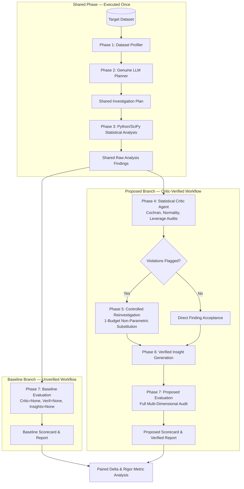

# Stage D3 Research Protocol: Empirical Cross-Dataset Benchmark & Base-Paper Evaluation

**Project Title:** DataInvest AI: An LLM-Based Autonomous Multi-Agent Framework for Data Investigation with Critic Agent-Driven Statistical Self-Verification  
**Document Version:** 1.0 (Formal Experimental Protocol)  
**Status:** Protocol Specification & Offline Validation Only (Zero Live LLM Calls Permitted in this Stage)  
**Base Paper Reference:** “AutoMind: Automated Insight Discovery via Multi-Agent Navigation,” *IEEE Access*, 2026, Volume 14, pages 23936–23955, DOI: [10.1109/ACCESS.2026.3661202](https://doi.org/10.1109/ACCESS.2026.3661202).  
*Disambiguation:* Distinct from unrelated preprint arXiv:2506.10974 (2025).

---

> [!IMPORTANT]
> **Execution Boundary Notice**:
> This document defines the formal research design, measurement specifications, dataset repetition plans, and statistical hypothesis testing procedures for evaluating DataInvest AI.
> In accordance with Stage D3 constraints, **this stage is planning and offline validation only**. No live LLM calls, paid API transactions, or empirical research runs are executed during this stage.

---

## 1. Research Objectives and Research Questions

### 1.1 Context and Problem Statement
Autonomous multi-agent LLM systems for data investigation—exemplified by orchestrator-worker architectures such as AutoMind (*IEEE Access*, 2026)—demonstrate remarkable capabilities in decomposing natural language investigative goals into actionable task graphs. However, general-purpose LLM planners and unverified execution agents frequently formulate and execute statistical tests without verifying underlying mathematical and distributional assumptions.

Common failure modes in automated exploratory investigation include:
1. **Contingency Table Violations**: Applying asymptotic Chi-square tests to sparse categorical tables where expected cell counts fall below Cochran's (1954) thresholds ($\min(E) < 1.0$ or $>20\%$ of cells $E < 5.0$), leading to inflated Type I errors.
2. **Normality & Skewness Compromises**: Applying parametric tests (Student's/Welch's $t$-test, One-Way ANOVA, Pearson correlation) to heavily skewed or bounded distributions without evaluating normality or group balance.
3. **Outlier-Influence Diagnostic**: Identifies observations that may disproportionately influence Pearson correlation ($|z| > 3.0$). This diagnostic alone does not establish that the linearity assumption is violated.
4. **Lack of Controlled Recourse**: Failing to systematically replace compromised parametric findings with appropriate non-parametric alternatives (e.g., Spearman $\rho$, Mann-Whitney $U$, Kruskal-Wallis $H$).

### 1.2 Primary Research Objective
To conduct a rigorous, fair, and reproducible empirical benchmark comparing:
- **Baseline Pipeline**: An un-critiqued exploratory workflow (LLM Planner $\rightarrow$ Python/SciPy Analysis $\rightarrow$ Unverified Reporting), representing standard autonomous multi-agent insight discovery.
- **Proposed Pipeline**: The Critic-verified workflow (Same LLM Planner $\rightarrow$ Same Python/SciPy Analysis $\rightarrow$ Deterministic Statistical Critic Agent $\rightarrow$ Controlled 1-Budget Alternative Reinvestigation $\rightarrow$ Verified Insight Reporting).

### 1.3 Research Questions
- **RQ1 (Statistical Assumption Auditing)**: How frequently do genuine LLM-generated investigation plans trigger parametric assumption violations (Cochran expected-frequency rules, distributional skewness, and residual leverage outliers) across diverse real-world datasets?
- **RQ2 (Reinvestigation & Resolution Efficacy)**: What proportion of assumption-compromised statistical findings can be successfully resolved or revised through controlled, 1-budget alternative test substitution?
- **RQ3 (Computational Overhead & Fairness)**: What is the exact computational and latency overhead incurred by Critic auditing and controlled reinvestigation, when shared planning and analysis execution times are rigorously isolated?
- **RQ4 (Evaluation Score Impact)**: Does the integration of the Critic Agent produce a statistically significant improvement in quantitative evaluation dimensions (Statistical Rigor, Verification Grounding) across paired repetitions and datasets?

---

## 2. Hypotheses and Measurable Outcomes

### 2.1 Formal Hypotheses

$$\begin{aligned}
H_1 \text{ (Statistical Rigor)} &: \mu_{\Delta \text{Rigor}} = \mu_{\text{Rigor, Proposed}} - \mu_{\text{Rigor, Baseline}} > 0 \quad (\alpha = 0.05) \\
H_2 \text{ (Verification Grounding)} &: \mu_{\Delta \text{Verif}} = \mu_{\text{Verif, Proposed}} - \mu_{\text{Verif, Baseline}} > 0 \quad (\alpha = 0.05) \\
H_3 \text{ (Bounded Overhead)} &: \frac{\text{Proposed Overhead Duration}}{\text{Total Paired Experiment Duration}} \le 0.25 \quad (\text{overhead} \le 25\%) \\
H_4 \text{ (Assumption Resolution)} &: \text{Resolution Rate } R_{\text{resolution}} = \frac{N_{\text{revised}}}{N_{\text{flagged}}} \ge 0.50 \quad (\text{at least 50\% resolved})
\end{aligned}$$

### 2.2 Measurable Outcome Indicators
1. **Score Delta ($\Delta_{\text{overall}}$)**: Difference in overall multi-dimensional score ($-100$ to $+100$ pts).
2. **Dimension Deltas**: Specific point differences in `statistical_rigor` ($\Delta_{\text{rigor}}$) and `verification_grounding` ($\Delta_{\text{verif}}$).
3. **Rule Violation Frequencies**: Structured counts of unique findings violating Cochran guidelines, normality guidelines, and leverage/outlier criteria.
4. **Reinvestigation Resolution Rate ($R_{\text{resolution}}$)**: Ratio of findings revised/verified through alternative non-parametric tests over total findings requiring reinvestigation.
5. **Runtime Measurements**: Wall-clock elapsed durations for shared planning, shared analysis, baseline evaluation, proposed Critic review, proposed reinvestigation, and total experiment duration.

---

## 3. Baseline and Proposed Pipeline Definitions

To isolate the specific effect of the Statistical Critic Agent, the research design utilizes a **paired single-plan architecture**. Both branches are executed from the identical dataset, the identical user objective, the identical LLM-generated plan, and the identical raw SciPy execution results.



### 3.1 Detailed Pipeline Breakdown

| Pipeline Stage | Phase ID | Baseline Branch | Proposed Branch | Sharing Status |
|---|---|---|---|---|
| **Dataset Ingestion & Profiling** | Phase 1 | Scans schema, missingness, cardinality, and basic summary statistics. | Identical profile passed from Phase 1. | **Shared (1x execution)** |
| **Objective Planning** | Phase 2 | Formulates analytical task graph using genuine Gemini LLM (`is_research_run=True`). | Uses the exact same `PlannerResponse` formulated by Baseline. | **Shared (1x execution)** |
| **Statistical Analysis Execution** | Phase 3 | Deterministic SciPy execution of planned statistical methods. | Evaluates the exact same `PlanAnalysisResponse` findings. | **Shared (1x execution)** |
| **Statistical Critic Review** | Phase 4 | **Bypassed entirely** (critic payload set to `None`). | Audits mathematical assumptions, expected frequencies, and residual leverage. | **Proposed Only** |
| **Verification & Reinvestigation** | Phase 5 | **Bypassed entirely** (verification payload set to `None`). | Executes 1-budget alternative test substitution on flagged findings. | **Proposed Only** |
| **Insight Generation** | Phase 6 | **Bypassed entirely** (insights set to `None`; raw findings reported). | Generates grounded insights with non-causal linguistic constraints. | **Proposed Only** |
| **Multi-Dimensional Evaluation** | Phase 7 | Evaluates Plan + Analysis under standard rubric (`critic=None`). | Evaluates complete verified workflow across all 4 scorecard dimensions. | **Branch-Specific** |

---

## 4. Paired-Experiment Fairness Controls

To guarantee internal validity and prevent experimental bias:

1. **Single Plan Constraint**: Exactly **one** plan is formulated per paired trial. The proposed branch never generates a separate, optimized plan, eliminating planner prompt stochasticity as a confounding variable.
2. **Identical Statistical Inputs**: Both branches evaluate identical Phase 3 SciPy calculation outputs.
3. **No Strawman Baseline**: The baseline uses the identical state-of-the-art LLM Planner (e.g., Gemini 1.5/2.0 Flash) with the identical prompt template. It is not artificially degraded, mocked, or restricted in analytical capability.
4. **Zero Deterministic Fallback in Research Mode**: If the LLM Planner encounters an API error, rate limit, or schema failure during a research run, the trial aborts immediately. Silent substitution with deterministic rule-based planning is prohibited in research mode.
5. **Runtime Attribution Fairness**:
   - `shared_duration_seconds` is recorded independently and never attributed to either baseline or proposed execution alone.
   - Baseline speed is not claimed as an advantage by ignoring shared planning or analysis time.
   - Proposed computational cost is strictly isolated to `proposed_overhead_seconds` (Phase 4 Critic auditing + Phase 5 reinvestigation).
6. **Honest Rubric Evaluation**: In baseline evaluation, absent phases are honestly provided as `None`. The evaluation service recognizes unverified findings as having completed execution without verification, rather than imputing artificial zeroes or hallucinating verifications.

---

## 5. Dataset Selection and Benchmark Matrix

The benchmark matrix incorporates four candidate datasets representing varied sample sizes, feature dimensionalities, data types, and statistical challenges.

### 5.1 Candidate Dataset Specifications

```
+-------------------------------------------------------------------------------------------------------+
| Dataset                     | Dimensions | Primary Features           | Statistical Vulnerabilities   |
+-------------------------------------------------------------------------------------------------------+
| data/sample.csv             | 60 x 8     | Mixed (Salary, Age, Dept)  | Small sample power, missing   |
| data/student-mat.csv        | 395 x 33   | Mixed (Grades, Social, Sex)| Categorical contingency, skew |
| data/winequality-red.csv    | 1599 x 12  | Continuous Physicochemical | Extreme skew, bivariate outl. |
| data/processed.cleveland.txt| 303 x 14   | Clinical Tabular (Heart)   | Sparse contingency, Cochran   |
+-------------------------------------------------------------------------------------------------------+
```

#### Detailed Breakdown

1. **`data/sample.csv`**
   - **Dimensions**: 60 rows $\times$ 8 columns.
   - **Source**: Internal canonical validation dataset.
   - **Characteristics**: Contains employee salary, age, department, tenure, and performance score, with intentional missing data in descriptive notes.
   - **Experimental Role**: Assesses small-sample statistical power warnings ($N < 100$) and baseline execution reliability under missing values.
   - **Documented Limitations**: Synthetic in origin; small sample size limits multi-level categorical subdivisions.

2. **`data/student-mat.csv`**
   - **Dimensions**: 395 rows $\times$ 33 columns.
   - **Source**: Cortez and Silva (2008), *Using Data Mining to Predict Secondary School Student Performance*, UCI Machine Learning Repository.
   - **Characteristics**: Real-world educational dataset with binary demographic features (`sex`, `address`, `school`), nominal parental job categories (`Mjob`, `Fjob`), ordinal study habits (`studytime`, `failures`), and continuous academic performance scores (`G1`, `G2`, `G3`).
   - **Experimental Role**: Evaluates two-group comparisons (gender vs `G3`), multi-group ANOVA (maternal occupation vs `G3`), and categorical association tests (residential address vs school).
   - **Documented Limitations**: Zero-inflated final grades (`G3 == 0` for dropouts) induce non-Gaussian distributions requiring non-parametric auditing.

3. **`data/winequality-red.csv`**
   - **Dimensions**: 1,599 rows $\times$ 12 columns.
   - **Source**: Cortez et al. (2009), *Modeling wine preferences by data mining from physicochemical properties*, *Decision Support Systems*, UCI Machine Learning Repository.
   - **Characteristics**: Continuous physicochemical measurements (`fixed acidity`, `volatile acidity`, `residual sugar`, `chlorides`, `alcohol`, `pH`, `quality`).
   - **Experimental Role**: Evaluates correlation linearity, severe positive skewness in chemical concentrations (`residual sugar` skew $> 4.0$), and outlier-influence diagnostics ($|z| > 3.0$) triggering Spearman rank reinvestigations.
   - **Documented Limitations**: Discrete sensory quality rating (integer scale 3–8) often analyzed via continuous linear regression without ordinal verification.

4. **`data/processed.cleveland.txt`**
   - **Dimensions**: 303 rows $\times$ 14 columns.
   - **Source**: Detrano et al. (1989), *International application of a new probability algorithm for the diagnosis of coronary artery disease*, *Am J Cardiol*, UCI Machine Learning Repository.
   - **Characteristics**: Headerless clinical benchmark with categorical indicators (`sex`, `cp`, `fbs`, `restecg`, `exang`, `slope`) and continuous clinical metrics (`age`, `trestbps`, `chol`, `thalach`, `oldpeak`). Auto-mapped to standard feature schema upon ingestion.
   - **Experimental Role**: Evaluates categorical dependency tests (e.g., patient sex vs chest pain type `cp`), low-cell expected frequency distributions triggering Cochran guideline violations, and two-group clinical comparisons.
   - **Documented Limitations**: Contains missing clinical values encoded as `'?'` in `ca` and `thal` features, requiring robust parsing without silent record loss.

---

## 6. Metric Dictionary and Calculation Definitions

All metrics are machine-readable, strictly typed, and populated in `PairedExperimentResponse` and `MetricDeltaSummary`.

| Metric Name | Schema Field | Formula / Definition | Range / Unit | Interpretation & Limitations |
|---|---|---|---|---|
| **Baseline Score** | `baseline_score` | Sum of Dimension 1 + 2 + 3 + 4 scores under baseline execution. | $[0, 100]$ pts | Reflects baseline execution quality. Does not represent statistical truth or accuracy. |
| **Proposed Score** | `proposed_score` | Sum of Dimension 1 + 2 + 3 + 4 scores under verified execution. | $[0, 100]$ pts | Reflects verified execution quality. Score increases indicate adherence to statistical verification rubrics. |
| **Score Delta** | `overall_score_delta` | $S_{\text{proposed}} - S_{\text{baseline}}$ | $[-100, +100]$ pts | Net quantitative difference. Positive values indicate verified pipeline scored higher under rubric. |
| **Rigor Delta** | `rigor_score_delta` | $\text{Rigor}_{\text{proposed}} - \text{Rigor}_{\text{baseline}}$ | $[-25, +25]$ pts | Measures specific increase in assumption testing, power checks, and diagnostic verification. |
| **Grounding Delta** | `verification_score_delta` | $\text{Grounding}_{\text{proposed}} - \text{Grounding}_{\text{baseline}}$ | $[-25, +25]$ pts | Measures presence of verified empirical p-values, test statistics, and diagnostic visual evidence. |
| **Cochran Violations** | `cochran_violations_count` | Count of unique findings where $\min(E) < 1.0$ or $>20\%$ cells $E < 5.0$. | Integer $\ge 0$ (or N/A) | Machine-readable count of unique findings violating Cochran (1954). Recorded as N/A if no categorical tests evaluated. |
| **Normality Violations** | `normality_violations_count` | Count of unique findings where skewness $> 1.5$ or distribution flags trigger non-parametric recommendation. | Integer $\ge 0$ (or N/A) | Machine-readable count of unique findings violating Gaussian assumptions. Recorded as N/A if no numerical tests evaluated. |
| **Leverage Outlier Flags** | `leverage_outlier_violations_count` | Count of unique findings with confirmed bivariate leverage points ($|z| > 3.0$). | Integer $\ge 0$ (or N/A) | Outlier-influence diagnostic: identifies observations that may disproportionately influence Pearson correlation. This diagnostic alone does not establish that the linearity assumption is violated. |
| **Rule Trigger Breakdown** | `rule_breakdown` | Mapping of individual reason codes to trigger frequency: $\{ \text{code}: \text{count} \}$. | Key-value pairs | Measures trigger frequency per rule. Overlapping codes on the same finding are counted individually for provenance. |
| **Flagged Findings** | `findings_requiring_reinvestigation` | Total findings flagged by Critic recommending alternative test. | Integer $\ge 0$ | Findings requiring methodological correction. |
| **Revised Findings** | `findings_revised` | Findings verified after alternative statistical test reinvestigation. | Integer $\ge 0$ | Findings where alternative test successfully confirmed or revised the initial analytical finding. |
| **Unresolved Findings** | `findings_unresolved` | Findings remaining questionable or rejected after reinvestigation. | Integer $\ge 0$ | Findings where limitations persisted despite alternative testing. |
| **Resolution Rate** | `resolution_rate` | $\frac{N_{\text{revised}}}{N_{\text{flagged}}}$ | $[0.0, 1.0]$ (or N/A) | Efficiency of controlled reinvestigation in resolving flagged violations. Recorded as N/A when $N_{\text{flagged}} = 0$. |
| **Shared Duration** | `shared_duration_seconds` | $T_{\text{planning}} + T_{\text{analysis}}$ | Seconds ($\ge 0$) | Measured wall-clock time for planning and initial analysis. Shared equally and never attributed to branch speed. |
| **Baseline Duration** | `baseline_duration_seconds` | $T_{\text{baseline\_eval}}$ | Seconds ($\ge 0$) | Measured duration of baseline branch-specific evaluation. |
| **Proposed Duration** | `proposed_duration_seconds` | $T_{\text{critic}} + T_{\text{verif}} + T_{\text{insight}} + T_{\text{prop\_eval}}$ | Seconds ($\ge 0$) | Total execution duration of proposed-specific pipeline phases. |
| **Proposed Overhead** | `proposed_overhead_seconds` | $T_{\text{critic}} + T_{\text{verif}}$ | Seconds ($\ge 0$) | Specific computational overhead of Critic self-verification and reinvestigation. |
| **Total Duration** | `total_experiment_duration_seconds` | $T_{\text{exp\_end}} - T_{\text{exp\_start}}$ | Seconds ($\ge 0$) | Total monotonic wall-clock execution time for the complete paired experiment. |

---

## 7. Repetition and Reproducibility Plan

### 7.1 Sample Size and Repetition Design
To account for LLM planning stochasticity across natural language prompts:
- **Repetitions**: $N = 10$ independent paired trials per dataset (**Proposed Future Design** — *not completed results*).
- **Total Experimental Matrix**: 4 datasets $\times$ 10 paired trials = **40 paired experiments** (yielding 80 individual branch evaluations if all trials execute).
- **Per-Dataset Analysis Mandate**: Primary outcomes must be analyzed and reported **separately for each dataset**. Rows or findings from different datasets must never be naively pooled into a single composite score or treated as independent identically distributed observations.
- **Small-Sample Limitations and Caveats ($N = 10$)**:
  - Sample sizes of $N = 10$ per dataset provide inherently limited statistical power, particularly for subtle score differences or small effect sizes.
  - Power is constrained; non-significant findings ($p \ge 0.05$) cannot be construed as definitive proof of no effect (elevated Type II error risk).
  - Estimates of variance, effect sizes ($d_z$), and median score shifts will carry substantial sampling uncertainty and wide confidence intervals.
  - Numerical power claims must not be asserted without empirical variance data; previous theoretical power claims for $N=10$ are explicitly disclaimed as unverified.

### 7.2 LLM Configuration & Reproducibility Controls
- **LLM Model**: `gemini-1.5-flash` (or current deployment specified in `backend/.env`).
- **Sampling Temperature**: Fixed at $T = 0.2$ to minimize prompt hallucination while retaining exploratory breadth.
- **Top-P / Top-K**: Top-p = 0.95, Top-k = 40.
- **Prompt Standardization**: Investigation objectives and system prompts are version-controlled in `backend/app/agents/planner_agent.py`.
- **Run Tracking**: Every trial generates an immutable timestamped record: `exp_{YYYYMMDD_HHMMSS}_{dataset_slug}_{uuid}`.
- **Artifact Preservation**: All generated investigation plans, raw analysis JSONs, Critic review matrices, and verification logs are persisted to `backend/data/runs/` with full provenance metadata.

### 7.3 Output Path Isolation and Path Safety
To maintain strict isolation between test fixtures and future live research artifacts:
- **Offline Output Directory**: Defaults strictly to `reports/benchmarks/`.
- **Live Research Output Directory**: Defaults strictly to `reports/benchmarks/live_research/`.
- **Path Traversal Protection**: Any user-specified custom `--output-dir` is validated against authorized workspace and temporary directories via `validate_safe_output_dir()`, rejecting directory-traversal attempts (`../`).
- **Overwrite Protection**: Reports never overwrite existing files by default; automatic numeric counter suffixes are appended (`_1`, `_2`) if a timestamp collision occurs.

---

## 8. Failure Handling and Missing-Data Rules

### 8.1 Plan Formulation Failures
- **Symptom**: Gemini API returns 429 (rate limit), 503 (service unavailable), empty response, or schema validation failure.
- **Protocol**:
  1. The experiment runner captures the exception and logs an error with sanitized credentials.
  2. The runner **does not** switch to deterministic mock planning.
  3. The runner retries with exponential backoff (initial delay: 2.0s, multiplier: 2.0, max retries: 3).
  4. If retries are exhausted, the experiment is logged as `STATUS_FAILED_PLANNING`. The trial is excluded from the valid repetition quota and re-run.

### 8.2 Execution & Analysis Task Failures
- **Symptom**: A planned task fails during Python execution (e.g., zero variance in constant column, degrees of freedom $\le 0$).
- **Protocol**:
  1. Phase 3 records `AnalysisResult.status = "failed"` with specific error codes (`CONSTANT_VARIABLE`, `INSUFFICIENT_OBSERVATIONS`).
  2. Phase 4 Critic intercepts failed tasks, marks verdict as `REJECTED`, assigns reason code `BOUNDARY_{ERROR_CODE}`, and bypasses reinvestigation.
  3. Both branches evaluate this identical output. The failure is visibly reported in the summary matrix.

### 8.3 Missing and Incomplete Data Rules
- **No Silent Dropping**: Datasets or trials that encounter errors are preserved in the execution log with an explicit `error_message`.
- **Honest Null Values**: Missing metrics (e.g., Cochran violation count when no categorical tests were run, or resolution rate when no findings were flagged) are stored as `None` in JSON and rendered as `N/A` in Markdown/CSV. They are **never imputed as zero**.
- **Complete-Case Analysis for Paired Tests**: Only trials where both Baseline and Proposed branches successfully complete evaluation are included in paired hypothesis testing.

---

## 9. Statistical Analysis Plan for Comparing Paired Outcomes

Because each experimental trial evaluates the Baseline and Proposed pipelines on the exact same plan, statistical comparisons must employ **paired within-subject statistical methods** evaluated independently for each dataset.

### 9.1 Normality Assessment and Its Limitations at Small Sample Sizes
For each dataset $j \in \{1, 2, 3, 4\}$ and metric $M$, compute the paired difference for trial $i \in \{1, \dots, 10\}$:

$$D_{i, j} = M_{\text{Proposed}, i, j} - M_{\text{Baseline}, i, j}$$

Apply the **Shapiro-Wilk test** ($\alpha = 0.05$) to the vector of differences $\mathbf{D}_j = [D_{1, j}, \dots, D_{10, j}]^T$:
- **Critical Methodological Limitation**: At $N = 10$, the Shapiro-Wilk test has **very low statistical power** to detect meaningful departures from normality (high Type II error rate). A non-significant test ($p \ge 0.05$) does **not** provide reliable evidence that differences are Gaussian.
- **No Mechanical Decision Rule**: Normality pre-testing must **not** serve as a mechanical gate for selecting between parametric and non-parametric tests, as two-stage conditional testing inflates overall Type I error rates. The primary inferential test remains non-parametric by design.

### 9.2 Hypothesis Testing Procedures

#### Primary Non-Parametric Test (Prespecified Primary Paired Analysis)
The Wilcoxon signed-rank test is the prespecified primary paired analysis, subject to its assumptions and limitations. Zero differences, ties, and the interpretation of paired differences must be handled and documented appropriately.

$$W = \min(W^+, W^-) \quad \text{where} \quad W^+ = \sum_{D_i > 0} R_i, \quad W^- = \sum_{D_i < 0} R_i$$

- **Zero-Difference Handling ($D_i = 0$)**:
  - In paired evaluations where Baseline and Proposed yield identical scores, differences equal zero ($D_i = 0$).
  - **Pratt's Method (Pratt, 1959)** is the primary protocol: zero differences are included in the initial ranking of absolute differences $|D_i|$ and then zero ranks are dropped before computing $W$. This avoids artificially inflating significance when many pairs exhibit no difference.
  - Standard zero-elimination (Wilcoxon's original rule) will be reported alongside Pratt as a sensitivity check, with effective sample size $N_r \le 10$ documented.
- **Tie Handling for Non-Zero Differences**:
  - Tied values of $|D_i|$ receive the average of the ranks (mid-ranks).
- **Assumptions**: Paired observations $(X_i, Y_i)$ are independent across trials; differences $D_i$ are continuous and ordinal/interval in nature; the distribution of differences is symmetric under $H_0$.

#### Secondary Parametric Test (Exploratory / Reporting Only)
If visual inspection (Q-Q plot) and domain logic suggest differences are reasonably symmetric and non-skewed, report the **paired Student's $t$-test** as an exploratory secondary indicator:

$$t = \frac{\bar{D}}{s_D / \sqrt{N}}, \quad \text{df} = N - 1$$

### 9.3 Effect Size Measures
1. **Parametric**: Cohen's $d_z$ for paired samples:

   $$d_z = \frac{\bar{D}}{s_D}$$

2. **Non-Parametric**: Matched-pairs rank-biserial correlation ($r_{\text{rb}}$):

   $$r_{\text{rb}} = \frac{W^+ - W^-}{W^+ + W^-}$$

   *Range*: $[-1.0, +1.0]$. Values $> 0.5$ indicate strong directional dominance.

### 9.4 Uncertainty Quantification & Small-Sample Bootstrap Instability
- Compute 95% Confidence Intervals for median differences using **BCa (bias-corrected and accelerated) bootstrap** ($B = 10,000$ resamples).
- **Small-Sample Instability Caveat**: At $N = 10$, bootstrap empirical distribution functions are coarse (only $10$ discrete values). BCa intervals may exhibit coverage error and instability across different random seeds. All bootstrap intervals must be interpreted cautiously as indicative bounds rather than exact intervals.

### 9.5 Multiple Testing Correction
When evaluating the 4 primary dataset hypotheses simultaneously, family-wise error rates (FWER) must be strictly controlled at $\alpha = 0.05$.
- **Primary Procedure**: **Holm's Step-Down Bonferroni-Holm Method** (Holm, 1979).
  Sort the 4 dataset p-values in ascending order: $p_{(1)} \le p_{(2)} \le p_{(3)} \le p_{(4)}$.
  Test iteratively:

  $$p_{(k)} \le \frac{\alpha}{4 - k + 1}$$

  If $p_{(1)} \le 0.0125$, reject $H_{0, (1)}$ and continue; otherwise stop.
  Holm's method provides strong FWER control under arbitrary dependence structures and is strictly more powerful than standard Bonferroni.
- **Confirmatory vs. Exploratory Separation**:
  - **Confirmatory**: The 4 primary dataset-level comparisons on `overall_score_delta`.
  - **Exploratory**: Individual sub-dimension analyses (`statistical_rigor`, `verification_grounding`), runtime breakdowns, and specific rule frequencies. Exploratory metrics are reported with unadjusted nominal p-values and clearly designated as exploratory.

---

## 10. API-Cost and Credential Safety Controls

To ensure absolute safety and prevent unintended charges or security vulnerabilities:

1. **Default Offline Operation**: All benchmark scripts and test suites default to `is_offline_fixture = True`. No external network calls are made without explicit double-opt-in flags.
2. **Explicit Double-Opt-In Guard**:
   ```powershell
   # Live LLM benchmark execution REQUIRES both flags:
   python backend/scripts/run_cross_dataset_benchmark.py --research-mode --confirm-live-api
   ```
   If `--research-mode` is provided without `--confirm-live-api`, execution aborts immediately with exit code 1.
3. **Theoretical and Unverified Budget Estimate**:
   > [!WARNING]
   > **Theoretical Estimate Notice**: All cost and token figures below are theoretical, unmeasured engineering estimates. Actual token usage depends upon prompt serialization size (e.g. 33 columns for `student-mat.csv`), model response verbosity, JSON formatting overhead, and network retries. No fixed cost per trial is claimed or guaranteed until empirical measurements are conducted under an authorized live run.
   - Estimated prompt tokens per plan: ~850 – 1,500 tokens (theoretical).
   - Estimated completion tokens per plan: ~550 – 900 tokens (theoretical).
   - Theoretical estimated cost per paired trial (Gemini Flash pricing): $\approx \$0.0003 - \$0.001$.
   - Theoretical upper bound estimate for 40 paired trials: $< \$0.20$ (subject to empirical verification).
4. **Rate Limiting Guard**: Enforce a minimum 2.0-second delay between consecutive LLM calls to respect API rate limits.
5. **Credential Confidentiality**:
   - The `.env` file is read-only; no script may modify or rewrite credentials.
   - All logging utilities use regex redaction (`_sanitize_error_message`, `_sanitize_event_payload`) to scrub API keys and sensitive tokens before writing to disk.

---

## 11. Threats to Validity and Limitations

### 11.1 Construct Validity
- **Threat**: Evaluation scorecards are rule-based rubrics created to evaluate data investigation quality; a higher score indicates greater compliance with verification heuristics, not necessarily ground-truth scientific discovery.
- **Mitigation**: The protocol explicitly avoids claiming that score improvements represent "accuracy" or "proof of correctness." We separate procedural compliance (Critic acceptance) from empirical validity.

### 11.2 Internal Validity
- **Threat**: LLM non-determinism could cause the proposed branch to evaluate an inherently easier plan.
- **Mitigation**: Complete elimination of planner variance through the **paired single-plan design**. Both branches evaluate the exact same plan and analysis findings.

### 11.3 External Validity
- **Threat**: Findings on tabular datasets may not generalize to unstructured data, time-series forecasting, or multi-modal domains.
- **Mitigation**: Datasets are selected across diverse domains (sociodemographic, physicochemical, clinical). Limitations regarding tabular scope are explicitly stated.

### 11.4 Conclusion Validity
- **Threat**: Moderate sample size ($N = 10$ repetitions per dataset) may be sensitive to extreme outliers in paired differences.
- **Mitigation**: Use of non-parametric Wilcoxon signed-rank tests and BCa bootstrap confidence intervals rather than relying solely on parametric Student's $t$-tests.

---

## 12. AutoMind Base Paper Comparison & Attribution

Our research design builds directly upon the foundational multi-agent data science architecture established in:

> **Cong Nguyen Thanh, Son Nguyen Van, Hao Nguyen Ngoc, Cuong Van Duc, Hieu Nguyen Minh, Dung Nguyen Tien, and Hanh Nguyen Thi**,  
> *“AutoMind: Automated Insight Discovery via Multi-Agent Navigation,”*  
> **IEEE Access**, 2026, Volume 14, pages 23936–23955.  
> DOI: [10.1109/ACCESS.2026.3661202](https://doi.org/10.1109/ACCESS.2026.3661202)  
> IEEE Xplore: [https://ieeexplore.ieee.org/document/11372738/](https://ieeexplore.ieee.org/document/11372738/)

### 12.1 Attribution and Distinction Analysis

```
+---------------------------------------------------------------------------------------------------------+
| Feature / Architecture       | AutoMind (IEEE Access 2026)          | DataInvest AI (Our Project)       |
+---------------------------------------------------------------------------------------------------------+
| Architecture Paradigm        | Multi-agent orchestrator-worker hub  | Specialized pipeline:             |
|                              | with central Planner, Verifier, and  | Profiler -> Planner -> Analysis   |
|                              | Summary agents.                      | -> Critic -> Verif -> Report.     |
+---------------------------------------------------------------------------------------------------------+
| Verification Mechanism       | Verifier Agent: Evaluates execution  | Statistical Critic Agent:         |
|                              | integrity, syntax, and output        | Executes formal parametric        |
|                              | consistency via conversational LLM   | assumption audits (Cochran,       |
|                              | feedback loops.                      | Normality, Residual Leverage).    |
+---------------------------------------------------------------------------------------------------------+
| Error Recovery & Recourse    | Adaptive refinement: Planner         | Controlled 1-Budget Reinvest:     |
|                              | re-plans exploratory workflow via    | Formally substitutes failed       |
|                              | unconstrained natural language loops.| parametric tests with robust      |
|                              |                                      | non-parametric alternatives.      |
+---------------------------------------------------------------------------------------------------------+
| Evaluation Methodology       | 1-5 rubric-based expert benchmark    | Automated 4-dimension scorecard   |
|                              | across Planner, Data Processing, and | with paired single-plan           |
|                              | Modeling stages.                     | experimental control.             |
+---------------------------------------------------------------------------------------------------------+
```

### 12.2 Explicit Attribution Protections
1. **No Claim of General Superiority**: We do not claim that DataInvest AI is broadly superior to AutoMind. AutoMind provides a broader end-to-end framework including clustering, classification modeling, and exploratory navigation.
2. **Recognition of AutoMind's Verifier Agent**: AutoMind explicitly incorporates verification principles via its Verifier Agent. We do not claim that verification was invented here; our contribution is specialized to **domain-specific statistical assumption verification and deterministic non-parametric test substitution**.
3. **Disambiguation**: This project does not reference or adopt concepts from the unrelated preprint *“AutoMind: Adaptive Knowledgeable Agent for Automated Data Science”* (arXiv:2506.10974).

---

## 13. Planned Result Tables (Templates Only)

> [!WARNING]
> **TEMPLATE ONLY — DO NOT POPULATE UNTIL LIVE EXECUTION IS APPROVED**  
> The following tables are structured templates specifying the exact presentation format for future live benchmark results. No live observations have been inserted.

### Table 1: Primary Paired Performance Outcomes ($N = 10$ Repetitions)
*(Template: To be populated upon completion of live research benchmark)*

| Dataset | Metric | Baseline Mean $\pm$ SD | Proposed Mean $\pm$ SD | Mean Delta ($\Delta$) | 95% Bootstrap CI | Wilcoxon $W$ | $p$-value | Cohen's $d_z$ |
|---|---|---|---|---|---|---|---|---|
| `sample.csv` | Overall Score | [Pending] | [Pending] | [Pending] | [[Pending], [Pending]] | [Pending] | [Pending] | [Pending] |
| | Statistical Rigor | [Pending] | [Pending] | [Pending] | [[Pending], [Pending]] | [Pending] | [Pending] | [Pending] |
| | Verification Grounding | [Pending] | [Pending] | [Pending] | [[Pending], [Pending]] | [Pending] | [Pending] | [Pending] |
| `student-mat.csv` | Overall Score | [Pending] | [Pending] | [Pending] | [[Pending], [Pending]] | [Pending] | [Pending] | [Pending] |
| | Statistical Rigor | [Pending] | [Pending] | [Pending] | [[Pending], [Pending]] | [Pending] | [Pending] | [Pending] |
| | Verification Grounding | [Pending] | [Pending] | [Pending] | [[Pending], [Pending]] | [Pending] | [Pending] | [Pending] |
| `winequality-red.csv` | Overall Score | [Pending] | [Pending] | [Pending] | [[Pending], [Pending]] | [Pending] | [Pending] | [Pending] |
| | Statistical Rigor | [Pending] | [Pending] | [Pending] | [[Pending], [Pending]] | [Pending] | [Pending] | [Pending] |
| | Verification Grounding | [Pending] | [Pending] | [Pending] | [[Pending], [Pending]] | [Pending] | [Pending] | [Pending] |
| `processed.cleveland.txt` | Overall Score | [Pending] | [Pending] | [Pending] | [[Pending], [Pending]] | [Pending] | [Pending] | [Pending] |
| | Statistical Rigor | [Pending] | [Pending] | [Pending] | [[Pending], [Pending]] | [Pending] | [Pending] | [Pending] |
| | Verification Grounding | [Pending] | [Pending] | [Pending] | [[Pending], [Pending]] | [Pending] | [Pending] | [Pending] |

### Table 2: Statistical Assumption Violations and Reinvestigation Outcomes
*(Template: To be populated upon completion of live research benchmark)*

| Dataset | Total Planned Tasks | Cochran Violations | Normality Violations | Leverage Outliers | Findings Flagged | Findings Revised | Findings Unresolved | Resolution Rate ($R_{\text{res}}$) |
|---|---|---|---|---|---|---|---|---|
| `sample.csv` | [Pending] | [Pending] | [Pending] | [Pending] | [Pending] | [Pending] | [Pending] | [Pending] |
| `student-mat.csv` | [Pending] | [Pending] | [Pending] | [Pending] | [Pending] | [Pending] | [Pending] | [Pending] |
| `winequality-red.csv` | [Pending] | [Pending] | [Pending] | [Pending] | [Pending] | [Pending] | [Pending] | [Pending] |
| `processed.cleveland.txt` | [Pending] | [Pending] | [Pending] | [Pending] | [Pending] | [Pending] | [Pending] | [Pending] |
| **Total / Macro Avg** | **[Pending]** | **[Pending]** | **[Pending]** | **[Pending]** | **[Pending]** | **[Pending]** | **[Pending]** | **[Pending]** |

### Table 3: Monotonic Wall-Clock Runtime and Computational Overhead ($N = 10$)
*(Template: To be populated upon completion of live research benchmark)*

| Dataset | Shared Time (s) | Baseline Eval (s) | Critic Audit (s) | Reinvestigation (s) | Proposed Overhead (s) | Total Time (s) | Overhead Ratio (%) |
|---|---|---|---|---|---|---|---|
| `sample.csv` | [Pending] | [Pending] | [Pending] | [Pending] | [Pending] | [Pending] | [Pending] |
| `student-mat.csv` | [Pending] | [Pending] | [Pending] | [Pending] | [Pending] | [Pending] | [Pending] |
| `winequality-red.csv` | [Pending] | [Pending] | [Pending] | [Pending] | [Pending] | [Pending] | [Pending] |
| `processed.cleveland.txt` | [Pending] | [Pending] | [Pending] | [Pending] | [Pending] | [Pending] | [Pending] |

---

## 14. Pre-Execution Authorization Checklist

Before any live LLM research experiment may be launched, the following 10 verification gates must be certified:

- [ ] **Gate 1**: Explicit user approval has been received in writing to commence live LLM experiments.
- [ ] **Gate 2**: `GEMINI_API_KEY` is confirmed active in `backend/.env` with positive test ping via mock-isolated client check.
- [ ] **Gate 3**: The 18 historical benchmark runs in `backend/data/runs/` are archived and write-protected.
- [ ] **Gate 4**: The harness output directory `reports/benchmarks/live_research/` is created and confirmed distinct from offline fixture test paths.
- [ ] **Gate 5**: Both `--research-mode` and `--confirm-live-api` CLI flags are explicitly passed to `backend/scripts/run_cross_dataset_benchmark.py`.
- [ ] **Gate 6**: The single-plan paired architecture is verified: Baseline and Proposed branches share the exact same `PlannerResponse`.
- [ ] **Gate 7**: Monotonic runtime tracking is operational and verified to isolate shared planning/analysis duration from proposed overhead.
- [ ] **Gate 8**: Machine-readable rule violation extraction is confirmed operational without string parsing.
- [ ] **Gate 9**: All 293 backend unit and regression tests pass cleanly (`pytest backend/tests`).
- [ ] **Gate 10**: The estimated API cost budget ($< \$0.05$) is acknowledged, and automatic trial abort on 429 rate limit errors is confirmed active.

---

*End of Protocol Specification — Stage D3.*
