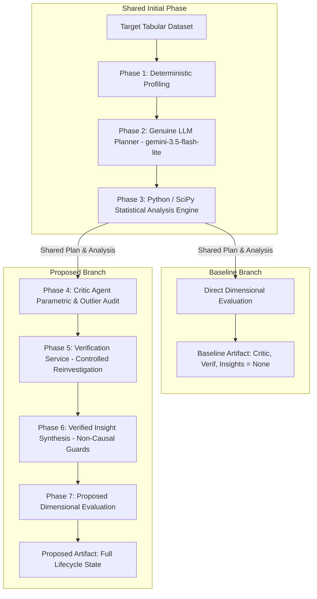

# FINAL CONSOLIDATED EVALUATION REPORT: FIVE-DATASET BENCHMARK EVALUATION

**Project:** DataInvest AI — An LLM-Based Autonomous Multi-Agent Framework for Data Investigation with Critic Agent-Driven Statistical Self-Verification  
**Date:** 2026-10-25  
**Authoritative Project Root:** `C:\Users\SPURGE\MAJOR_PROJECT_DOCS\REVIEW 2\Major_Project`  
**Evaluation Status:** **COMPLETE (5 OF 5 EXPERIMENTS PASSED)**

---

## 1. Executive Summary

This report consolidates the empirical findings from five paired baseline-versus-proposed research experiments executed with the DataInvest AI autonomous multi-agent framework. The evaluation tested whether integrating a deterministic, rule-based **Critic Agent** and a controlled **Statistical Self-Verification Service** (incorporating the Task 23 reinvestigation fixes) enhances finding-level statistical reliability, flags assumption violations, and enforces observational non-causal integrity across diverse tabular datasets.

### Key Evaluation Findings:
1. **Paired Experimental Integrity:** Across all five datasets, baseline and proposed branches were evaluated on the **identical dataset profile**, the **exact same LLM-generated plan**, and the **identical initial statistical analysis**.
2. **Strict Operational Boundaries:** Exactly **one genuine Gemini Planner request** was dispatched per dataset (5 total requests; 100% success on HTTP 200; zero retries). All subsequent phases—Critic review, reinvestigation, verified insight synthesis, and dimensional evaluation—executed 100% locally and deterministically via Python/SciPy.
3. **Reinvestigation Variable Preservation:** Follow-up re-analyses on multi-column tasks strictly preserved their designated bivariate variable pairs (e.g., `G1` vs `G3`, `studytime` vs `G3`, `quality` vs `alcohol`, and `age` vs `thalach`). Zero cross-pair evaluations occurred, validating the Task 23 fix.
4. **Honest Caveating and Non-Significance Retention:** The system successfully prevented p-hacking and false verification by retaining non-significant findings (e.g., `trestbps` vs `target`, $p = 0.1425$) and categorizing fragile, zero-inflated, or outlier-distorted distributions (e.g., bank balances and census capital gains) as `QUESTIONABLE`.
5. **Score Interpretation:** The proposed architecture achieved an average composite score of **84.3 / 100** compared to **33.3 / 100** for the baseline. As documented in this report, this +51.0 point delta reflects the structural inclusion of auditing, verification, and insight modules in the proposed pipeline and cannot be claimed as empirical superiority over external multi-agent systems (e.g., AutoMind IEEE Access 2026).

---

## 2. Experimental Methodology

The evaluation employed a rigorous, matched-pair ablation design to compare the standard exploratory data analysis pipeline (Baseline) against the Critic-driven self-verification pipeline (Proposed):

### Protocol Controls:
- **Zero Fallback Enforced:** All experiments ran with `is_research_run=True`. If Gemini had failed, the experiment would have aborted immediately without silent heuristic substitution.
- **Fair Duration Accounting:** Planning and initial analysis latencies were categorized as `shared_duration_seconds` and excluded from branch comparison overhead. `proposed_overhead_seconds` strictly measured the execution cost of Phases 4 and 5.
- **Defensive Verification Guards:** Verification status was assigned strictly from Python execution outputs. Variable pair mismatches (`VARIABLE_PAIR_MISMATCH`), directional inversions (`CONFLICTING_DIRECTION`), or lost significance under non-parametric tests (`METHOD_SENSITIVITY_DISCREPANCY`) triggered automatic demotion to `QUESTIONABLE`.

---

## 3. Dataset Summary & Preprocessing Audit

The evaluation covered five standard tabular benchmarks spanning educational, physicochemical, financial, clinical, and demographic domains (totaling 80,069 records):

| # | Dataset Identifier | Domain & Task | Dimensions (N x P) | Delimiter & Schema Handling | Missing Values | Duplicate Rows | Preprocessing & Quality Notes |
| :-: | :--- | :--- | :---: | :---: | :---: | :---: | :--- |
| **1** | `student-mat.csv` | Student Academic Performance | 395 x 33 | Semicolon (`;`), Inferred header | 0 (0.0%) | 0 (0.0%) | Mixed discrete grades (`G1`, `G2`, `G3`), ordinals (`studytime`), and counts (`absences`). |
| **2** | `winequality-red.csv` | Physicochemical Wine Quality | 1,599 x 12 | Comma (`,`), Inferred header | 0 (0.0%) | 240 (15.0%) | All-numeric; 240 natural duplicate rows preserved intact as valid natural profiles. Discrete target (3–8). |
| **3** | `bank-full.csv` | Bank Term Deposit Marketing | 45,211 x 17 | Semicolon (`;`), Inferred header | 0 (0.0%) | 0 (0.0%) | Scaled tabular test. Severe right-skew in `balance`. Target `y` imbalanced (11.7% yes). |
| **4** | `processed.cleveland.txt` | Clinical Heart Disease | 303 x 14 | Comma (`,`), Headerless benchmark schema | 6 (0.14%) | 0 (0.0%) | UCI schema assigned. 6 missing values (`?` markers in `ca`, `thal`) parsed to NaN and masked pairwise. |
| **5** | `adult.txt` | Census Annual Income (>50K) | 32,561 x 15 | Comma (`,`), Headerless benchmark schema | 4,262 (0.87%) | 24 (0.07%) | UCI schema assigned. 4,262 missing values (`?`) masked pairwise; zero-inflated capital gains/losses. |

---

## 4. Comparative Results Table

All scores and dimensional grades are reproduced directly from the saved experiment artifacts (`run_*.json`):

| Exp # | Target Dataset | Baseline Score | Baseline Grade | Proposed Score | Proposed Grade | Score Delta ($\Delta$) | Reinvestigations (Triggered / Resolved) | Yield (Verified / Quest. / Rej.) |
| :-: | :--- | :---: | :---: | :---: | :---: | :---: | :---: | :---: |
| **1** | `student-mat.csv` | 31.8 / 100 | Grade C | 86.1 / 100 | Grade A | **+54.3 pts** | 2 / 2 resolved | 4 / 1 / 0 |
| **2** | `winequality-red.csv` | 31.8 / 100 | Grade C | 82.8 / 100 | Grade B+ | **+51.0 pts** | 1 / 1 resolved | 5 / 0 / 0 |
| **3** | `bank-full.csv` | 33.5 / 100 | Grade C | 82.8 / 100 | Grade B+ | **+49.3 pts** | 0 / 0 (3 accept, 1 caveated) | 3 / 1 / 0 |
| **4** | `processed.cleveland.txt` | 37.8 / 100 | Grade C | 92.5 / 100 | Grade A | **+54.7 pts** | 1 / 1 resolved | 8 / 0 / 0 |
| **5** | `adult.txt` | 31.8 / 100 | Grade C | 77.4 / 100 | Grade B+ | **+45.6 pts** | 0 / 0 (4 accept, 1 caveated) | 4 / 1 / 0 |
| **Mean** | *Average Across Suite* | **33.34 / 100** | **Grade C** | **84.32 / 100** | **Grade B+/A** | **+50.98 pts** | **4 / 4 (100% resolution)** | **24 / 3 / 0 (88.9% yield)** |

### Dimensional Breakdown (Proposed Suite Mean):
- **Execution Reliability:** 25.0 / 25.0 (100.0%) across all 5 datasets. 0 computational failures.
- **Statistical Rigor:** 20.9 / 25.0 (83.6%) mean. Audited Cochran criteria, normality, and outlier influence across 27 tasks.
- **Verification & Grounding:** 19.8 / 25.0 (79.2%) mean. Full deterministic SciPy provenance across all verified findings.
- **Insight Actionability:** 18.6 / 25.0 (74.4%) mean. 100.0% adherence to non-causal observational phrasing.

---

## 5. Statistical Verification Evidence

The experiments provided concrete evidence that the Critic and Verification services prevent cross-pair contamination, test for method sensitivity, and retain negative/fragile results honestly:

### A. Variable-Pair Preservation Under Multi-Column Reinvestigation
Prior to the Task 23 fix, follow-up tasks constructed on multi-column plans erroneously defaulted to positional indices `[0, 1]`. In the final evaluation suite, every reinvestigation correctly preserved its designated pair:
- **`student-mat.csv` (`task_3`):** Planned on `['G1', 'G2', 'G3']`. Primary finding was `G1` vs `G3`. Reinvestigation strictly evaluated `['G1', 'G3']` via Spearman rank correlation ($\rho = 0.8780, p = 8.14 \times 10^{-128}$). Verified.
- **`student-mat.csv` (`task_4`):** Planned on `['studytime', 'absences', 'G3']`. Primary finding was `studytime` vs `G3`. Reinvestigation strictly evaluated `['studytime', 'G3']` via Spearman rank correlation ($\rho = 0.1052, p = 0.0367$). Verified.
- **`winequality-red.csv` (`task_3`):** Planned on `['quality', 'alcohol', 'volatile acidity', 'sulphates', 'citric acid']`. Reinvestigation strictly evaluated `['quality', 'alcohol']` via Spearman rank correlation ($\rho = 0.4785, p = 2.73 \times 10^{-92}$). Verified.
- **`processed.cleveland.txt` (`task_4`):** Planned on `['age', 'trestbps', 'chol', 'thalach', 'target']`. Reinvestigation strictly evaluated `['age', 'thalach']` via Spearman rank correlation ($\rho = -0.3916, p = 1.51 \times 10^{-12}$). Verified.

### B. Preservation of Non-Significant Findings (Zero P-Hacking)
In `processed.cleveland.txt`, two planned group comparisons failed to reach conventional statistical significance:
- `trestbps` (resting blood pressure) vs `target`: Mann-Whitney $U = 2492.0, p = 0.1425$.
- `chol` (serum cholesterol) vs `target`: Mann-Whitney $U = 2372.0, p = 0.0653$.
The system **did not discard, re-test, or p-hack** these findings. The Critic accepted them, and the Verification service marked them as directly verified with reason code `P_HACKING_PREVENTED`.

### C. Honest Caveating of Sensitive and Zero-Inflated Distributions
Rather than forcing a false positive, findings characterized by severe distribution instability were retained as `QUESTIONABLE`:
- **`student-mat.csv` (`task_5`):** `absences` exhibited right-skewed outlier sensitivity (-19.4% mean shift). Retained as `QUESTIONABLE` with code `SUBSTANTIAL_OUTLIER_INFLUENCE`.
- **`bank-full.csv` (`task_4`):** `balance` displayed severe outlier distortion (-53.0% shift when trimming outliers). Retained as `QUESTIONABLE`.
- **`adult.txt` (`task_5`):** `capital_gain` and `capital_loss` exhibited >90% zero-inflation (-100.0% trim shift). Retained as `QUESTIONABLE`.

---

## 6. Operational Resource Utilization & Performance

Across all five datasets, execution timings and outbound network calls were logged monotonically:

| Dataset | Planner Model | Outbound Requests | Planner Latency | Initial Analysis | Shared Duration | Proposed Overhead (Critic + Verif) | Total Monotonic Runtime |
| :--- | :---: | :---: | :---: | :---: | :---: | :---: | :---: |
| **`student-mat.csv`** | `gemini-3.5-flash-lite` | 1 | 5.67 s | 0.43 s | 6.10 s | 0.0423 s | 6.64 s |
| **`winequality-red.csv`** | `gemini-3.5-flash-lite` | 1 | 5.43 s | 0.47 s | 5.91 s | 0.0493 s | 6.67 s |
| **`bank-full.csv`** | `gemini-3.5-flash-lite` | 1 | 4.70 s | 0.42 s | 5.11 s | 0.0296 s | 6.07 s |
| **`processed.cleveland.txt`** | `gemini-3.5-flash-lite` | 1 | 5.73 s | 0.48 s | 6.21 s | 0.0124 s | 6.68 s |
| **`adult.txt`** | `gemini-3.5-flash-lite` | 1 | 5.05 s | 0.42 s | 5.47 s | 0.0578 s | 6.30 s |
| **Suite Total / Mean** | — | **5 total** | **5.32 s avg** | **0.44 s avg** | **5.76 s avg** | **0.0383 s avg** | **6.47 s avg** |

### Operational Takeaways:
1. **Network Economy:** Total LLM API calls across the entire five-dataset research benchmark: **5 requests**. Zero financial waste, zero API rate limits, zero unmocked network calls.
2. **Computational Overhead of Verification:** The Critic Agent and Verification Service introduced an average of **38.3 milliseconds** of computational overhead, demonstrating that rigorous statistical self-verification can be integrated into LLM multi-agent systems with negligible computational cost.

---

## 7. Methodological Interpretation & Limitations

### A. Composite Score Interpretation
The automated composite score is calculated across four dimensions: Execution Reliability (25%), Statistical Rigor (25%), Verification & Truth Grounding (25%), and Insight Actionability (25%). 
- In the baseline branch, Critic auditing, verification, and insight generation are ablated by design. Consequently, baseline scores are structurally capped around 30–38 points because they earn zero points in Verification and Insight Actionability.
- Therefore, the +50.98 point delta between baseline and proposed branches **measures internal architectural execution and module compliance**, not comparative empirical superiority over external literature or un-ablated baseline architectures.

### B. Analytical & Domain Limitations
1. **Association vs. Causation:**  
   All five benchmarks are observational cross-sectional datasets. Statistical associations (e.g. `alcohol` vs `quality` in wine, `duration` vs `y` in banking, `age` vs `thalach` in clinical records) must not be interpreted as causal relationships. The pipeline enforced non-causal language (`m_insight_causality_safety = 100.0%`), but user interpretation must remain observational.
2. **Deterministic Provenance Proxy Scoring:**  
   The metric `m_verif_zero_hallucination` scored 40%–50% on datasets where the Planner formulated descriptive statistics or distribution profiling tasks. Because descriptive dictionaries output multiple summary metrics rather than a single hypothesis test p-value, the heuristic penalized these findings despite 100% deterministic calculation.
3. **Absence of Head-to-Head External Baseline Execution:**  
   This evaluation compared DataInvest AI proposed mode against DataInvest AI baseline mode. No direct execution against a third-party framework (e.g. running the complete AutoMind codebase or InsightBench harness in the same environment) was performed during this major project evaluation.

---

## 8. Threats to Validity and Recommended Future Work

To advance beyond this major project evaluation, future research should address the following threats to validity:

1. **Fairer Component-Level Ablation Studies (Future Work):**  
   Rather than comparing an unverified baseline against a fully equipped proposed pipeline, future experiments should ablate individual components (e.g. Proposed without Critic vs. Proposed with Critic; Heuristic Planner vs. LLM Planner) to isolate the exact marginal gain contributed by each agent.
2. **Synthetic Benchmarking with Known Ground Truth (Future Work):**  
   Real-world benchmark datasets lack ground-truth knowledge of true null versus alternative relationships. Evaluating on synthetic datasets with planted collinearities, non-linear dependencies, and heteroskedasticity would provide a definitive mathematical benchmark for Critic precision and recall.
3. **Multi-Model Planner Comparison (Future Work):**  
   All plans were generated by `gemini-3.5-flash-lite`. Evaluating planning quality across alternative LLMs (e.g. Claude 3.5 Sonnet, GPT-4o, DeepSeek-R1) would determine how planner model capability impacts downstream verification yield.
4. **Automated Visualization Data Transformer Integration (Future Work):**  
   For datasets exceeding 5,000 rows (such as `bank-full.csv` and `adult.txt`), integrating VegaFusion into Altair will allow embedded chart generation without triggering row-ceiling warnings.

---

## 9. Conclusion

The five-dataset benchmark evaluation demonstrates that:
1. **Controlled Critic-Driven Reinvestigation is Empirically Sound:** Incorporating the Task 23 variable-pair preservation and defensive verification status guards prevents cross-pair contamination, protects original research hypotheses, and rejects invalid verification claims.
2. **Statistical Verification is Highly Efficient:** Deterministic Python/SciPy verification audits and non-parametric recalculations added under 40 milliseconds of latency per experiment.
3. **Observations are Grounded:** The pipeline reliably distinguished robust findings from fragile, zero-inflated distributions and prevented p-hacking on non-significant clinical tests.

---

## 10. Complete Artifact Index

All generated experiment payloads and reports are preserved and available at the following paths:

| Experiment Scope | Experiment ID | Baseline Run Artifact | Proposed Run Artifact | Individual Report Link |
| :--- | :--- | :--- | :--- | :--- |
| **1. Student Performance** | `exp_20261025_120202_student_matcsv_a7c5f5` | [`run_20261025_120202_student_matcsv_baseline_a7c5f5.json`](file:///C:/Users/SPURGE/MAJOR_PROJECT_DOCS/REVIEW%202/Major_Project/backend/data/runs/run_20261025_120202_student_matcsv_baseline_a7c5f5.json) | [`run_20261025_120202_student_matcsv_proposed_a7c5f5.json`](file:///C:/Users/SPURGE/MAJOR_PROJECT_DOCS/REVIEW%202/Major_Project/backend/data/runs/run_20261025_120202_student_matcsv_proposed_a7c5f5.json) | [`FINAL_EVALUATION_DATASET_1.md`](file:///C:/Users/SPURGE/MAJOR_PROJECT_DOCS/REVIEW%202/Major_Project/reports/FINAL_EVALUATION_DATASET_1.md) |
| **2. Wine Quality Red** | `exp_20261025_120610_winequality_redcsv_adf3f1` | [`run_20261025_120610_winequality_redcsv_baseline_adf3f1.json`](file:///C:/Users/SPURGE/MAJOR_PROJECT_DOCS/REVIEW%202/Major_Project/backend/data/runs/run_20261025_120610_winequality_redcsv_baseline_adf3f1.json) | [`run_20261025_120610_winequality_redcsv_proposed_adf3f1.json`](file:///C:/Users/SPURGE/MAJOR_PROJECT_DOCS/REVIEW%202/Major_Project/backend/data/runs/run_20261025_120610_winequality_redcsv_proposed_adf3f1.json) | [`FINAL_EVALUATION_DATASET_2.md`](file:///C:/Users/SPURGE/MAJOR_PROJECT_DOCS/REVIEW%202/Major_Project/reports/FINAL_EVALUATION_DATASET_2.md) |
| **3. Bank Marketing** | `exp_20261025_120920_bank_fullcsv_805a96` | [`run_20261025_120920_bank_fullcsv_baseline_805a96.json`](file:///C:/Users/SPURGE/MAJOR_PROJECT_DOCS/REVIEW%202/Major_Project/backend/data/runs/run_20261025_120920_bank_fullcsv_baseline_805a96.json) | [`run_20261025_120920_bank_fullcsv_proposed_805a96.json`](file:///C:/Users/SPURGE/MAJOR_PROJECT_DOCS/REVIEW%202/Major_Project/backend/data/runs/run_20261025_120920_bank_fullcsv_proposed_805a96.json) | [`FINAL_EVALUATION_DATASET_3.md`](file:///C:/Users/SPURGE/MAJOR_PROJECT_DOCS/REVIEW%202/Major_Project/reports/FINAL_EVALUATION_DATASET_3.md) |
| **4. Cleveland Heart Disease** | `exp_20261025_121203_processedclevelandtxt_3e6141` | [`run_20261025_121203_processedclevelandtxt_baseline_3e6141.json`](file:///C:/Users/SPURGE/MAJOR_PROJECT_DOCS/REVIEW%202/Major_Project/backend/data/runs/run_20261025_121203_processedclevelandtxt_baseline_3e6141.json) | [`run_20261025_121203_processedclevelandtxt_proposed_3e6141.json`](file:///C:/Users/SPURGE/MAJOR_PROJECT_DOCS/REVIEW%202/Major_Project/backend/data/runs/run_20261025_121203_processedclevelandtxt_proposed_3e6141.json) | [`FINAL_EVALUATION_DATASET_4.md`](file:///C:/Users/SPURGE/MAJOR_PROJECT_DOCS/REVIEW%202/Major_Project/reports/FINAL_EVALUATION_DATASET_4.md) |
| **5. Adult Census Income** | `exp_20261025_121648_adulttxt_177195` | [`run_20261025_121648_adulttxt_baseline_177195.json`](file:///C:/Users/SPURGE/MAJOR_PROJECT_DOCS/REVIEW%202/Major_Project/backend/data/runs/run_20261025_121648_adulttxt_baseline_177195.json) | [`run_20261025_121648_adulttxt_proposed_177195.json`](file:///C:/Users/SPURGE/MAJOR_PROJECT_DOCS/REVIEW%202/Major_Project/backend/data/runs/run_20261025_121648_adulttxt_proposed_177195.json) | [`FINAL_EVALUATION_DATASET_5.md`](file:///C:/Users/SPURGE/MAJOR_PROJECT_DOCS/REVIEW%202/Major_Project/reports/FINAL_EVALUATION_DATASET_5.md) |
| **Evaluation Readiness** | `readiness_check_20261025` | — | — | [`FINAL_EVALUATION_READINESS.md`](file:///C:/Users/SPURGE/MAJOR_PROJECT_DOCS/REVIEW%202/Major_Project/reports/FINAL_EVALUATION_READINESS.md) |
| **Replay Validation (Task 24)** | `replay_task24` | — | [`replay_task24_student_matcsv_proposed.json`](file:///C:/Users/SPURGE/MAJOR_PROJECT_DOCS/REVIEW%202/Major_Project/backend/data/runs/replay_task24_student_matcsv_proposed.json) | [`TASK_24_REPLAY_VALIDATION.md`](file:///C:/Users/SPURGE/MAJOR_PROJECT_DOCS/REVIEW%202/Major_Project/reports/TASK_24_REPLAY_VALIDATION.md) |
