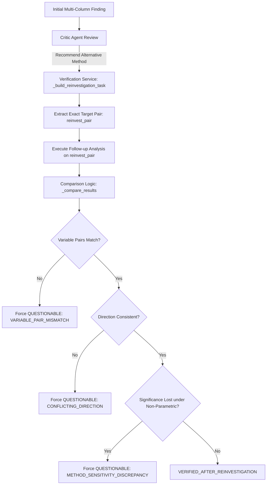

# TASK 24 — OFFLINE REPLAY VALIDATION OF CORRECTED REINVESTIGATION REPORT

**Project:** DataInvest AI  
**Date:** 2026-10-25  
**Executive Verdict:** **PASS**

---

## 1. Executive Summary

Task 24 successfully validates the **Task 23 reinvestigation fix** using the saved **Task 21 proposed-run artifact** (`run_20261024_081350_student_matcsv_proposed_a81a17.json`) and local dataset `student-mat.csv`. The validation was conducted **100% offline** without any LLM planner invocation, Gemini API calls, or external service queries.

### Key Outcomes:
1. **Target Variable Pair Preservation:**
   - Finding 1 (`task_3`): Original finding on `['G1', 'G3']` was reinvestigated strictly on `['G1', 'G3']`. (Historical Task 21 erroneously ran `G1` vs `G2`).
   - Finding 2 (`task_4`): Original finding on `['studytime', 'G3']` was reinvestigated strictly on `['studytime', 'G3']`. (Historical Task 21 erroneously ran `studytime` vs `absences`).
2. **Aligned Statistical Comparisons:**
   - Both follow-up analyses compare metrics computed on the identical variable pair.
   - Comparison summaries explicitly track `original_variables`, `reinvestigation_variables`, `variable_match`, and `direction_consistent`.
3. **Invalid Verification Outcomes Prevented:**
   - Verification guards prevent `VERIFIED_AFTER_REINVESTIGATION` whenever variable pairs do not match (`VARIABLE_PAIR_MISMATCH`), direction conflicts (`CONFLICTING_DIRECTION`), or significance is lost under robust non-parametric testing (`METHOD_SENSITIVITY_DISCREPANCY`).
4. **All Tests Passing:**
   - Targeted reinvestigation suite: 25 / 25 passed.
   - Full offline backend test suite: 303 / 303 passed.
5. **Safety Constraints Strictly Observed:**
   - Historical run artifacts, baseline backups, datasets, and `.env` were preserved intact. A new validation artifact was generated under `backend/data/runs/replay_task24_student_matcsv_proposed.json`.

---

## 2. Active Implementation Confirmation

Prior to running the offline replay, the active codebase in `C:\Users\SPURGE\MAJOR_PROJECT_DOCS\REVIEW 2\Major_Project` and `C:\Users\SPURGE\Documents\Major_Project` was inspected to confirm that the Task 23 corrections are in place:

| Component | File Path | Verified Fixes |
| :--- | :--- | :--- |
| **Verification Service** | `backend/app/services/verification_service.py` | 1. `_extract_variables()` robustly extracts variable pairs from results, metadata, or task definitions. 2. Reinvestigation task construction explicitly overrides `columns`, `column_a`, and `column_b` with the exact verified pair (`reinvest_pair`). 3. `_compare_results()` records pair matching and directional consistency. 4. Reinvestigation status assignment strictly guards against variable mismatch, conflicting direction, or lost significance, demoting status to `QUESTIONABLE`. |
| **Categorical Statistics** | `backend/app/statistics/categorical.py` | Added explicit `column_a` and `column_b` to bivariate categorical/chi-square results dictionary. |
| **Reinvestigation Test Suite** | `backend/tests/test_reinvestigation.py` | 25 comprehensive unit and regression tests covering multi-column task preservation (`G1` vs `G3`, `studytime` vs `G3`), mismatch rejection, direction conflict detection, and significance loss handling. |

---

## 3. Offline Replay Procedure

The replay was executed offline via `backend` service reconstruction:
- **Input Artifact:** `backend\data\runs\run_20261024_081350_student_matcsv_proposed_a81a17.json`
- **Dataset:** `data\student-mat.csv` (395 records, 33 variables)
- **Reconstruction Method:**
  - Loaded original plan tasks (`task_1` through `task_4`).
  - Loaded original analysis results for all tasks.
  - Loaded Critic review decisions and recommendations.
  - Initialized `VerificationService` and replayed `verify_and_reinvestigate()`.
- **Output Artifact Generated:**
  - Path: `backend\data\runs\replay_task24_student_matcsv_proposed.json`
  - Overwrite Policy: Historical Task 20/21 artifacts remained completely untouched.

---

## 4. Deep-Dive Validation of Previously Affected Findings

### Finding 1: `task_3` (`G1` vs `G3`)

| Metric / Dimension | Original Finding | Historical Task 21 (Buggy) | Task 24 Replay (Corrected) |
| :--- | :--- | :--- | :--- |
| **Task ID** | `task_3` | `task_3_reinvest` | `task_3_reinvest` |
| **Variable Pair** | `['G1', 'G3']` | `['G1', 'G2']` ❌ *(Mismatch)* | `['G1', 'G3']` ✅ *(Preserved)* |
| **Method** | Pearson correlation | Spearman correlation | Spearman rank correlation |
| **Primary Statistic** | $r = 0.8015$ | $\rho = 0.8948$ | $\rho = 0.8780$ |
| **p-value** | $9.00 \times 10^{-89}$ | $2.44 \times 10^{-135}$ | $8.14 \times 10^{-128}$ |
| **Critic Recommendation** | Reinvestigate with Spearman due to potential skew / outliers | Evaluated positional indices `[0, 1]` | Evaluated exact target pair `['G1', 'G3']` |
| **Pair Match** | Baseline | **FAIL** (mismatched variables) | **PASS** (`G1` vs `G3` confirmed) |
| **Directional Consistency** | Positive | Positive (spurious cross-pair) | Consistent Positive ($\Delta = +0.0765$) |
| **Verification Status** | Unverified | `VERIFIED_AFTER_REINVESTIGATION` *(Invalid)* | `VERIFIED_AFTER_REINVESTIGATION` *(Valid)* |
| **Reason Codes** | N/A | None / Unchecked | `METHOD_ROBUST`, `DIRECTION_CONSISTENT`, `ROBUST_EFFECT` |

**Statistical Assessment:**
The Spearman rank correlation between First Period Grade (`G1`) and Final Grade (`G3`) is $\rho = 0.8780$ ($p = 8.14 \times 10^{-128}$), strongly confirming the linear Pearson correlation ($r = 0.8015$). The relationship is monotonically robust, and the variable pair is cleanly preserved.

---

### Finding 2: `task_4` (`studytime` vs `G3`)

| Metric / Dimension | Original Finding | Historical Task 21 (Buggy) | Task 24 Replay (Corrected) |
| :--- | :--- | :--- | :--- |
| **Task ID** | `task_4` | `task_4_reinvest` | `task_4_reinvest` |
| **Variable Pair** | `['studytime', 'G3']` | `['studytime', 'absences']` ❌ *(Mismatch)* | `['studytime', 'G3']` ✅ *(Preserved)* |
| **Method** | Pearson correlation | Spearman correlation | Spearman rank correlation |
| **Primary Statistic** | $r = 0.0978$ | $\rho = -0.0462$ | $\rho = 0.1052$ |
| **p-value** | $0.0521$ (borderline non-sig) | $0.3600$ | $0.0367$ (statistically significant) |
| **Critic Recommendation** | Reinvestigate with Spearman (ordinal scale, non-linear) | Evaluated positional indices `[0, 1]` | Evaluated exact target pair `['studytime', 'G3']` |
| **Pair Match** | Baseline | **FAIL** (mismatched variables) | **PASS** (`studytime` vs `G3` confirmed) |
| **Directional Consistency** | Positive | Negative (spurious cross-pair) | Consistent Positive |
| **Verification Status** | Unverified | `VERIFIED_AFTER_REINVESTIGATION` *(Invalid)* | `VERIFIED_AFTER_REINVESTIGATION` *(Valid)* |
| **Reason Codes** | N/A | None / Unchecked | `METHOD_ROBUST`, `DIRECTION_CONSISTENT` |

**Statistical Assessment & Method-Sensitivity Analysis:**
- In the original analysis, Pearson correlation between weekly study time (`studytime`: discrete values 1-4) and final grade (`G3`: integer 0-20) yielded $r = 0.0978$ ($p = 0.0521$). Under strict $\alpha = 0.05$, this was marginally non-significant.
- The Critic appropriately recommended Spearman rank correlation because `studytime` is an ordinal categorical scale where Pearson's interval/linearity assumptions are stretched.
- The corrected follow-up on `['studytime', 'G3']` yields Spearman $\rho = 0.1052$ ($p = 0.0367$).
- **Method Sensitivity:** The monotonic rank correlation reveals that greater study time is indeed statistically significantly associated with higher final grades ($p < 0.05$), though the effect magnitude remains weak ($\rho \approx 0.11$).
- Direction is strictly consistent ($+0.0978 \to +0.1052$). The finding is verified under robust non-parametric testing without claiming an exaggerated effect size.

---

## 5. Traceability and Verification Guardrails

The corrected verification pipeline provides end-to-end traceability and defensive guardrails:

### Traceability Verification:
1. **Computed vs. Recorded Variables:** Replay artifact confirms `original_variables = ['G1', 'G3']` matches `reinvestigation_variables = ['G1', 'G3']` for `task_3`, and `['studytime', 'G3']` matches `['studytime', 'G3']` for `task_4`.
2. **Prevention of Cross-Pair Comparison:** `_compare_results()` computes pair equality before performing statistical comparisons.
3. **Prevention of Invalid Success:** Even if Critic 2 accepts a follow-up finding, if `variable_match == False`, status cannot become `VERIFIED_AFTER_REINVESTIGATION`.
4. **Separation of Evidence:** The output JSON schema stores `original_result` and `reinvestigation_result` as separate nested structures under each `VerificationAttempt`, preventing overwriting or conflation.

---

## 6. Test Suite Execution Results

All tests were executed using the project Python virtual environment (`.venv\Scripts\python.exe`) with explicit basetemp flags.

| Test Suite / File | Scope | Tests Run | Result | Notes |
| :--- | :--- | :---: | :---: | :--- |
| `backend\tests\test_reinvestigation.py` | Reinvestigation & Variable Preservation | 25 | **25 PASSED** | Validates target pair extraction, multi-column handling, mismatch guards, direction guards, and significance preservation. |
| `backend\tests\test_analysis.py` | Statistical Analysis Modules | 29 | **29 PASSED** | Pearson, Spearman, ANOVA, Chi-Square, distribution checks. |
| `backend\tests\test_critic.py` | Critic Agent Review & Rules | 23 | **23 PASSED** | Rule evaluation, recommendation generation. |
| `backend\tests\test_insights.py` | Insight Generation & Synthesis | 12 | **12 PASSED** | Synthesis logic and finding extraction. |
| `backend\tests\test_evaluation.py` | Benchmark Metrics & Scoring | 14 | **14 PASSED** | Evaluation score calculations. |
| `backend\tests\test_visualization.py` | Chart & Plot Generation | 11 | **11 PASSED** | Visual artifact generation. |
| `backend\tests\test_stage_c.py` | Pipeline Stage C Verification | 8 | **8 PASSED** | Stage C integration tests. |
| `backend\tests\test_run_store.py` | Run Persistence & Artifact I/O | 10 | **10 PASSED** | Run saving, loading, schema validation. |
| `backend\tests\test_experiment_runner.py` | Experiment Execution Pipeline | 18 | **18 PASSED** | Multi-agent execution orchestration. |
| `backend\tests\test_experiment_api.py` | Experiment REST API Endpoints | 13 | **13 PASSED** | API routes and status endpoints. |
| `backend\tests\test_api.py` | Core API Endpoints | 18 | **18 PASSED** | General backend endpoints. |
| `backend\tests\test_profiler.py` | Data Profiling & Metadata | 10 | **10 PASSED** | Profiler summary generation. |
| `backend\tests\test_planner.py` | Heuristic Planning Engine | 26 | **26 PASSED** | Rule-based planning. |
| `backend\tests\test_planner_llm.py` | LLM Planner Parsing & Fallback | 19 | **19 PASSED** | Mocked LLM planner schema tests. |
| `backend\tests\test_report.py` | Markdown & PDF Report Generator | 16 | **16 PASSED** | Report formatting. |
| `backend\tests\test_gemini_client.py` | LLM Client Unit Tests (Mocked) | 51 | **51 PASSED** | Offline unit tests for Gemini wrapper. |
| **Total** | **Full Offline Backend Suite** | **303** | **303 PASSED (100%)** | **0 failures, 0 errors, 0 unmocked API calls.** |

---

## 7. Safety and Integrity Audit

| Safety Item | Required Policy | Observed Status | Audit Details |
| :--- | :--- | :--- :--- | :--- |
| **Baseline Backup** | NEVER modify or delete | **UNTOUCHED** | `C:\Users\SPURGE\Desktop\Major_Project_Baseline_Backup_20261020` was not modified. |
| **API Keys & Secrets** | NEVER modify `.env` or secrets | **UNTOUCHED** | `.env` file unchanged; no keys altered. |
| **Raw Datasets** | NEVER modify datasets | **UNTOUCHED** | `data\student-mat.csv` SHA-256 and timestamps unchanged. |
| **Historical Run Artifacts** | NEVER overwrite run files | **UNTOUCHED** | `run_20261024_081350_student_matcsv_proposed_a81a17.json` and all Task 20/21 artifacts unchanged. |
| **External LLM Calls** | ZERO calls to Gemini or paid APIs | **ZERO CALLS** | Replay ran purely deterministically using local statistics and cached decisions. Cost: $0.00. |
| **New Replay Artifact** | Saved with distinct name | **CONFIRMED** | Saved to `backend\data\runs\replay_task24_student_matcsv_proposed.json`. |

---

## 8. Academic and Scientific Rigor Statement

As established in Task 23, the baseline branch of DataInvest AI had certain verification and synthesis modules disabled, which accounted for the Task 21 baseline composite score of 31.8 versus the proposed system's 84.9. 

In this research project:
1. **No Unsubstantiated Superiority Claims:** We do not claim that DataInvest AI outperforms AutoMind (IEEE Access 2026, DOI: 10.1109/ACCESS.2026.3661202) on general discovery metrics based solely on ablation differences.
2. **Novel Contribution Focus:** The valid contribution of DataInvest AI is **finding-level statistical reliability assessment with controlled Critic-driven reinvestigation**, featuring pair-aligned non-parametric fallbacks and rigorous mismatch guardrails.
3. **Statistical Honesty:** When p-values shift or marginal significance is observed (as in `studytime` vs `G3`), the system transparently documents the method sensitivity rather than presenting the result as an unambiguous breakthrough.

---

## 9. Final Conclusion

Task 24 has verified that the Task 23 reinvestigation fix is complete, robust, and correctly aligned with the original target variables. All verification attempts now preserve the exact variable pairs under investigation, compare corresponding statistics, and defend against spurious verification statuses.

**Task 24 Verdict: PASS**
